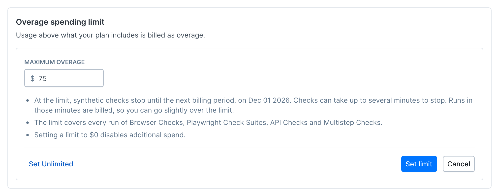
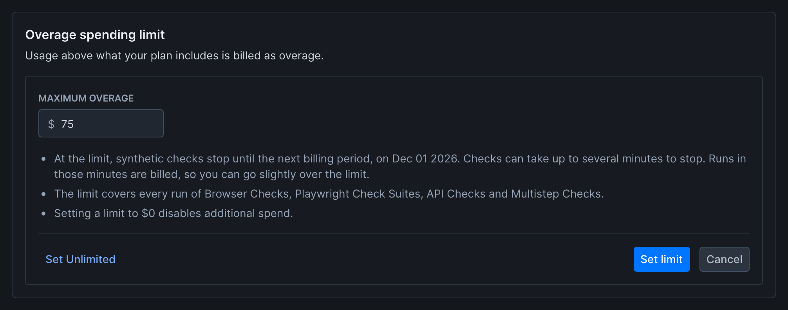
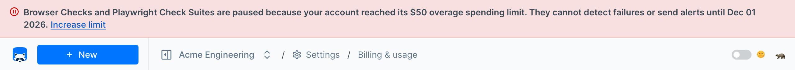
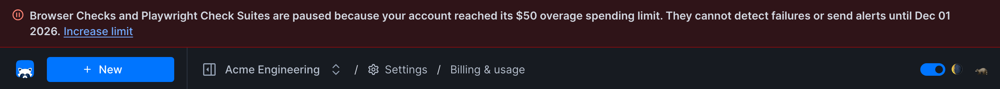

The overage spending limit is the most your account can pay for [overage](/admin/usage#overage) in one billing period, on top of your plan. When the overage reaches the limit, synthetic checks stop running until the next billing period starts, or until you raise or remove the limit.

The limit is available on the Starter and Team plans. The [CLI](/cli/checkly-account#checkly-account-spending-cap), the [Public API](#public-api) and the [MCP Server](/ai/mcp-server/tools#billing-tools) call it the spending cap.

## What the limit covers

The limit covers overage dollars only, not your whole bill. Your plan price and add-ons are paid in full, whatever the limit is.

For example, on a $29 plan with a limit of $50, you pay up to $79 for the billing period: $29 for the plan and up to $50 of overage.

Only [check runs](/admin/usage#what-counts-as-a-check-run) count toward the limit:

- API check runs and Multistep check runs
- Browser check runs and Playwright Check Suite runs

Uptime monitors and heartbeat monitors don't count toward the limit, and they keep running when the limit is reached. SMS and phone call alerts don't count toward the limit either. They have their own monthly quota.

- **A limit of $0** allows no overage. Checks stop as soon as your plan's included check runs are used up.
- **No limit** is the default. Overage is billed with no maximum, and checks never stop for overage.

A limit of $0 is not the same as no limit.

## Setting the limit

<Steps>
  <Step title="Open the billing page">
    Select [**Billing & usage**](https://app.checklyhq.com/settings/account/billing) in the left sidebar, then the **Plan & invoices** tab.
  </Step>
  <Step title="Edit the limit">
    On the **Overage spending limit** card, select **Edit**, enter the amount and select **Set limit**.
  </Step>
</Steps>

<Frame>
  
  
</Frame>

To remove the limit, select **Set Unlimited** on the same card and confirm. Without a limit, checks never stop and all overage is billed.

You can also set the limit in the **Set your limits** step when you subscribe to or change a Starter or Team plan. The limit is saved after the plan change goes through. It applies to the current billing period right away.

The card shows the limit and the overage used so far in this billing period.

## When the account reaches the limit

When the overage of the billing period reaches the limit, these checks stop:

- **API checks and Multistep checks** stop once their included check runs are used up.
- **Browser checks and Playwright Check Suites** stop once their included check runs are used up.

Each type stops only when it has used its own included check runs. For example, if your Browser check runs caused the overage but your API check runs are still under what your plan includes, API and Multistep checks keep running until they use their included check runs too.

While checks are stopped:

- Scheduled runs don't start, so the stopped checks can't detect failures or send alerts.
- You can't run the stopped check types from the web app, and CLI test sessions such as `npx checkly test` and `npx checkly trigger` are rejected with the message `Account has reached its spending cap. Raise or remove the cap to run more checks.`
- Uptime monitors and heartbeat monitors keep running and alerting.
- Members who can see the limit get a banner in the web app that says which checks are paused.

<Frame>
  
  
</Frame>

<Warning>
Checks can take up to several minutes to stop after the overage reaches the limit. Check runs in those minutes are billed, so your overage can go slightly over the limit.
</Warning>

Checks start again:

- When the next billing period starts.
- Within minutes when you raise the limit above the overage so far, or remove the limit.

## Yearly plans

On a yearly plan, the limit covers the whole 12-month billing period, not each month. The included check runs of a yearly plan are also counted for the whole year.

Overage on a yearly plan is invoiced every time it reaches $300. When the account reaches its limit, the overage that isn't invoiced yet is invoiced soon after, instead of at the next $300. See [Overage](/admin/usage#overage).

## Emails

Members who can change billing, Owners and Admins by default, get these emails about the limit:

| Email | When |
| --- | --- |
| Close to your limit | The overage reaches 80% of the limit. A limit of $0 has no close to limit email. |
| Your checks have stopped | The overage reaches the limit. On a yearly plan, it also says which overage is invoiced now. |
| Your limit was set, changed or removed | Someone sets, changes or removes the limit. The email says who made the change. When the limit changes several times in a row, you get one email about 5 minutes after the last change. |

Each email goes out at most once per billing period. On a yearly plan, the close to limit and checks stopped emails can go out again about every 30 days. For the emails about included check runs and overage, see [Usage emails](/admin/usage#usage-emails).

## Who can see and change the limit

| Action | Permission | Built-in roles |
| --- | --- | --- |
| See the limit and the overage so far | [`billing:read`](/admin/team-management/permissions#billing) and [`usage:read`](/admin/team-management/permissions#usage) | Owner, Admin |
| Set, change or remove the limit | [`billing:update`](/admin/team-management/permissions#billing) | Owner, Admin |

Read & Write, Read & Run and Read Only members don't see the limit card. To give other members access, use a [custom role](/admin/team-management/custom-roles) with these permissions. `billing:update` needs `usage:read` and `billing:read`.

## Public API

Use the [Public API](/api-reference/billing/get-the-spending-cap) to read and change the limit:

- `GET /v1/billing/spending-cap` returns the limit and how much overage the billing period has so far.
- `PUT /v1/billing/spending-cap` sets the limit. Send `{ "spendingCapCents": 5000 }` for a limit of $50, `{ "spendingCapCents": 0 }` for no overage, or `{ "spendingCapCents": null }` to remove the limit.

Amounts are in US cents. The endpoints need a [user or service API key](/admin/creating-api-key) with the permissions in [Who can see and change the limit](#who-can-see-and-change-the-limit). Legacy account API keys get a `401`. Plans that can't have a limit, such as prepaid and contract plans, get a `409` when you set a limit.

```bash Terminal
curl -X PUT "https://api.checklyhq.com/v1/billing/spending-cap" \
  -H "Authorization: Bearer $CHECKLY_API_KEY" \
  -H "X-Checkly-Account: $CHECKLY_ACCOUNT_ID" \
  -H "Content-Type: application/json" \
  -d '{ "spendingCapCents": 5000 }'
```

## CLI and MCP Server

- **CLI:** [`npx checkly account spending-cap`](/cli/checkly-account#checkly-account-spending-cap) shows the limit, and `set <dollars>` and `remove` change it. Available since CLI v10.3.0.
- **MCP Server:** the [`get-spending-cap`, `set-spending-cap` and `remove-spending-cap`](/ai/mcp-server/tools#billing-tools) tools let an AI agent read and change the limit. The agent asks you to confirm every change.
