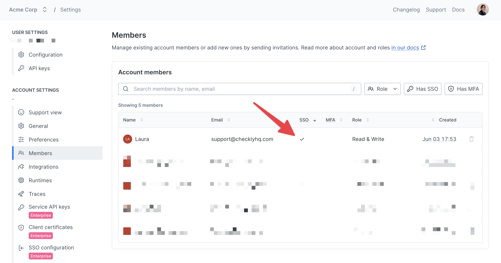

<Note>
SSO is only available for Checkly's [enterprise plans](https://www.checklyhq.com/pricing/).

Until we've set up your connection, the [SSO configuration page](https://app.checklyhq.com/settings/account/sso-saml) shows an upgrade prompt, even on an Enterprise plan.
</Note>

## Setting up the connection

The general process is detailed below, but please reach out to your customer success team or to [support@checklyhq.com](mailto:support@checklyhq.com) if you have questions or concerns. We're flexible and are more than happy to work with you on your specific use case.

<Steps>
  <Step title="Email support@checklyhq.com">
    To get started with SSO, email [support@checklyhq.com](mailto:support@checklyhq.com). We'll review your account and ask you a few questions.

    Let us know when the person who manages your identity provider (IdP) is ready to set up the connection, since the self-serve link we send expires.
  </Step>
  <Step title="Exchange SSO connection information">
    We'll send you a self-serve link to set up the SSO connection. This includes instructions for configuring the connection in your IdP, plus a place to upload your connection metadata to Checkly.

    You can connect any IdP that supports SAML, or use a Microsoft Entra ID, Okta or Google Workspace connection. For the values to enter in your IdP, see [Configuring your identity provider](/admin/team-management/single-sign-on#configuring-your-identity-provider).

    <Info>
      The self-serve link is valid for 5 days. After accessing the link, you'll have five hours to complete the setup and can access it up to 10 times. This limit is pre-set by our authentication tool and isn't controlled by us.

      If your self-serve link expires, let us know, and we'll generate another one for you. Alternatively, you can follow the manual setup process below.
    </Info>

    <Note>
      If you need our logo for the Checkly IdP tile, download one of these:

      - <a href="/images/sso-logos/checkly-icon-square.png" download target="_blank" rel="noopener noreferrer">Square icon</a>
      - <a href="/images/sso-logos/checkly-logo-light-bg.png" download target="_blank" rel="noopener noreferrer">Logo for light backgrounds</a>
      - <a href="/images/sso-logos/checkly-logo-dark-bg.png" download target="_blank" rel="noopener noreferrer">Logo for dark backgrounds</a>
      - <a href="/images/sso-logos/checkly-wordmark-light-bg.png" download target="_blank" rel="noopener noreferrer">Wordmark for light backgrounds</a>
      - <a href="/images/sso-logos/checkly-wordmark-dark-bg.png" download target="_blank" rel="noopener noreferrer">Wordmark for dark backgrounds</a>
    </Note>

    <Accordion title="Alternative process: manual setup">
      We highly recommend using the self-serve link process mentioned above. If that doesn't work for any reason, we can manually configure the connection. 

      The information provided is for the SAML protocol — let us know if you need something other than SAML.

      First, send us your:

      * email domain(s)
      * sign in URL
      * sign out URL (optional)
      * public X509 certificate

      Then, we'll send configuration details for your end:

      * Postback URL
      * Logout URL (optional)
      * XML metadata
      * Entity ID

      The most important thing is that we get the email address back from your SSO Idp.

      Thus, please make sure the attributes returned include an "email" and "name" field, e.g.

      ```
      {
        "email": <USER_EMAIL>,
        "name": <USER_NAME>
      }
      ```

      For how to configure a SAML connection with your IdP, please refer to your IdP's documentation:

      * [Google Workspace](https://knowledge.workspace.google.com/admin/apps/set-up-your-own-custom-saml-app)
      * [Microsoft Entra ID](https://learn.microsoft.com/en-us/entra/identity/enterprise-apps/add-application-portal-setup-sso)
      * [Okta](https://support.okta.com/help/s/article/How-To-Configure-A-Custom-SAML-App)

    </Accordion>
  </Step>
  <Step title="Test the connection">
    Test the connection by logging in to Checkly through your IdP dashboard. If you'd like, we can join a call to test it with you.

    Once logged in to Checkly, verify the SSO connection worked by going to the [Members page](https://app.checklyhq.com/accounts/settings/account/members) (open **Account settings** from the left sidebar, then select **Members**) and make sure there is a checkmark in the SSO column for your user:

    

    If you see that SSO checkmark, congratulations! The connection works. If not, no worries — let us know and we can set up a call to troubleshoot.

    <Note>
      When existing users log in via SSO, a new user will be created. This is expected, as detailed [here](/admin/team-management/single-sign-on#migrating-existing-users-to-sso).
    </Note>  
  </Step>
  <Step title="Enable SP-initiated SSO (optional)">
    If you would like [SP-initiated SSO](/admin/team-management/single-sign-on#service-provider-sp-initiated) enabled, let us know. We'll update the connection with your company's email domains.

    Ask for this only after you see the SSO checkmark. From then on, every login with an email address from those domains goes to your SSO connection, so a broken connection blocks those logins until it's fixed.
  </Step>
  <Step title="Migrate existing users to SSO (optional)">
    We recommend [migrating your existing users to SSO](/admin/team-management/single-sign-on#migrating-existing-users-to-sso).

    This is not required, but we highly recommend it to prevent any confusion with duplicate users. 
  </Step>
  <Step title="Setup complete">
    If you have any questions or need to modify your SSO connection, please reach out to [support@checklyhq.com](mailto:support@checklyhq.com).
  </Step>
</Steps>

## Configuring your identity provider

For a SAML connection, your IdP needs these values from us. The self-serve link shows them, and in the manual setup we send them to you. `<connection>` is the name of your SSO connection, which we choose when we set it up.

| Value | Format |
|-------|--------|
| Postback URL, also called ACS URL or Reply URL | `https://auth.checklyhq.com/login/callback?connection=<connection>` |
| Entity ID, also called Audience URI or Identifier | `urn:auth0:checkly:<connection>` |
| XML metadata | `https://auth.checklyhq.com/samlp/metadata?connection=<connection>` |
| Logout URL (optional) | `https://auth.checklyhq.com/logout` |

Enter the Postback URL and Entity ID in these fields:

* **Okta:** **Single sign-on URL** and **Audience URI (SP Entity ID)**.
* **Microsoft Entra ID:** **Reply URL (Assertion Consumer Service URL)** and **Identifier (Entity ID)**, under **Basic SAML Configuration**.
* **Google Workspace:** **ACS URL** and **Entity ID**, under **Service provider details**.

Add two attributes with exactly these names: `email`, set to the user's email address, and `name`, set to the user's name.

Then assign the users or groups that should use Checkly to the app in your IdP.

## Logging in with SSO

We support both IdP- and SP-initiated SSO.

### Identity provider (IdP) initiated 

IdP-initiated SSO happens when you login to Checkly through your IdP. Typically, this means going to your IdP dashboard and selecting the "Checkly" application. 

Checkly enables this by default, though there may be extra configuration needed on your IdP's side.

### Service provider (SP) initiated

SP-initiated SSO happens when you login to Checkly directly by going to [app.checklyhq.com](https://app.checklyhq.com/) and entering your email address. 

<Warning>
Using the "Continue with Google" or "Continue with Github" buttons will not redirect to SSO — you must use the email address field.
</Warning>

To check if SP-initiated SSO is enabled for your account, go to your [SSO configuration page](https://app.checklyhq.com/accounts/settings/account/sso-saml) and make sure the **Domain Aliases** field is filled. Email logins from those domains will route to your SSO connection.

To update this setting, reach out to [support@checklyhq.com](mailto:support@checklyhq.com) with the email domain(s) that you'd like added.

## Just-in-time (JIT) provisioning

When JIT is enabled, new users who sign in through your SSO connection will be automatically added to your account.

Users will be created with the default role specified on your [SSO settings page](https://app.checklyhq.com/settings/account/sso-saml), which the account Owner can change at any time. Under **Default Role**, you can pick **Read only**, **Read & Run** or **Read & Write**. Until you change it, it's **Read & Write**.

We enable JIT by default when we set up your SSO connection. The account owner can turn it off with the **JIT Provisioning** toggle on the [SSO settings page](https://app.checklyhq.com/settings/account/sso-saml).

JIT adds a new user to every account that uses your SSO connection and has JIT turned on, as long as the account has a free seat. Pending invites take up seats too. If none of these accounts has a free seat, someone signing in through SSO for the first time can't get in, so make sure each account's user limit covers your SSO users.

## Migrating existing users to SSO

When you log in with SSO for the first time, our system creates a new user. If you already have a Checkly user through a different login method, you will see duplicate users (one created through SSO and another with your previous login method) until your remove the non-SSO user.

<Tip>
  Users logging in with SSO have a check mark in the SSO column on your [Members page](https://app.checklyhq.com/settings/account/members):
  
</Tip>

If you have users created outside of SSO, we recommend migrating them to SSO:

1. Have the team member log out.
2. Have the team member log in with SSO. 
    * If [JIT](/admin/team-management/single-sign-on#just-in-time-jit-provisioning) is enabled, they will automatically be added to your Checkly account. 
    * Otherwise, you will need to send them an invite via the [Members page](https://app.checklyhq.com/settings/account/members).
3. Update the team member's role via the [Members page](https://app.checklyhq.com/settings/account/members).
4. Remove the team member's old non-SSO user.
    * If there are any API keys tied to this user, you will need to re-generate them. We recommend using [Service API keys](https://app.checklyhq.com/settings/account/service-api-keys) instead, since they are tied to your account and not individual users.

<Note>
  If you're migrating the account Owner to SSO, [transfer ownership](/admin/team-management/overview#transferring-ownership) to their new SSO user before you remove their old user. The Owner can't be removed from the account.
</Note>

If you need assistance with this, we encourage you to contact [our Support team](mailto:support@checklyhq.com).

## Frequently asked questions

### Why do I see duplicate users?

See [Migrating existing users to SSO](/admin/team-management/single-sign-on#migrating-existing-users-to-sso).

### Do you support SCIM?

Currently, SCIM is not supported. If you'd like to add SCIM support, please let us know so we can record your interest as feedback.

### How can I manage user roles?

Currently, we do not support SCIM or any IdP-based role mapping. 

Admins and Owners can manually set user roles on the [Members page](https://app.checklyhq.com/settings/account/members), or you can programmatically manage roles using our [CLI](/cli/checkly-members#checkly-members-update) or [public API](/api-reference/accounts/update-a-current-account-member-role).

### How can we enforce SSO for all team members?

You can take several steps to make sure only SSO users are in your account:

* Make sure [SP-initiated logins](/admin/team-management/single-sign-on#service-provider-sp-initiated) are enabled.
* [Migrate all users to SSO.](/admin/team-management/single-sign-on#migrating-existing-users-to-sso)
* Periodically remove non-SSO users. You can do this manually on the [Members page](https://app.checklyhq.com/settings/account/members) or automatically using our [CLI](/cli/checkly-members#checkly-members-delete) or [public API](/api-reference/accounts/remove-a-current-account-member).
* Do not send invitations to users, since they can accept invitations with a non-SSO login. Instead, they should [login through SSO](/admin/team-management/single-sign-on#logging-in-with-sso) and be automatically [JIT provisioned](/admin/team-management/single-sign-on#just-in-time-jit-provisioning) to you account.

Currently, there is no option to require SSO for account members. If you’d like to see this added, please let us know so we can record your interest as feedback.

### My X.509 certificate or client secret is expiring. What should I do?

Your X.509 certificate (for SAML connections) or client secret (for OIDC connections) must be replaced before it expires, otherwise your users won't be able to log in.

If you have a SAML connection:
* Our team will reach out when your X.509 certificate is about four weeks from expiring.
* Your team must regenerate the certificate and then either send it to [support@checklyhq.com](mailto:support@checklyhq.com) securely and we'll update it, or we can send you a link to update it directly.

If you have an OIDC connection:
* Client secret expirations are not communicated to our authentication provider, so we won't know when your secret expires. You must check your IdP for the client secret expiration date. Some client secrets might not have an expiration.
* Your team must regenerate the secret and then either send it to [support@checklyhq.com](mailto:support@checklyhq.com) securely and we'll update it, or we can send you a link to update it directly.