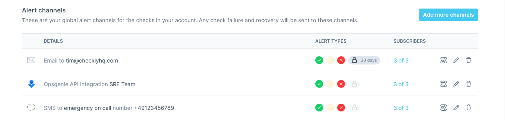

import AlertChannelSecrets from '/snippets/alert-channel-secrets-callout.mdx';

Alert channels determine **how** alert notifications reach your team when checks fail, degrade, or recover. Checkly supports a wide range of notification methods to fit your team's communication preferences and operational workflows.

## Available alert channels

### Communication Platforms
- [Email](/integrations/alerts/email)
- [Slack](/integrations/alerts/slack)
- [Discord](/integrations/alerts/discord)
- [Telegram](/integrations/alerts/telegram)
- [SMS](/integrations/alerts/sms)
- [Phone Call](/integrations/alerts/phone-calls)
- [Microsoft Teams](/integrations/alerts/msteams)
- [GitLab Alerts](/integrations/alerts/gitlab_alerts)

### Incident Management
- [PagerDuty](/integrations/incident-management/pagerduty)
- [Opsgenie](/integrations/incident-management/opsgenie)
- [FireHydrant](/integrations/incident-management/firehydrant)
- [Incident.io](/integrations/incident-management/incidentio)
- [Rootly](/integrations/incident-management/rootly)
- [ilert](/integrations/incident-management/ilert)
- [Splunk On-Call](/integrations/incident-management/splunk-on-call)
- [Spike.sh](/integrations/incident-management/spike)
- [StatusPage](/integrations/incident-management/statuspage)

### Custom Integrations
- [Webhooks](/integrations/alerts/webhooks)

## Managing alert channels

### Channel Configuration Overview

Configure channels with flexible subscription and filtering options:

<Steps>
<Step title="Create alert channel">
Choose your notification method and provide connection details
</Step>

<Step title="Configure Alert Types">
Select which types of events should trigger notifications
</Step>

<Step title="Subscribe Checks">
Choose which checks and check groups use this channel
</Step>

<Step title="Test Integration">
Verify the channel works correctly with test notifications
</Step>
</Steps>

## Subscribing checks and groups

A check alerts through a channel when it's subscribed to it. You can subscribe many checks and groups at once from the channel:

1. Open the channel from **Alert channels**.
2. In the **Subscriptions** section, click **Add subscribers**.
3. Search by name, or filter by **Type**. Select checks and groups one by one, or select the header checkbox to select all of them.
4. Click the button that adds them, for example **Add 3 subscribers**. Then save the channel.

**Remove all** unsubscribes every check and group when you save. A new channel starts with every check and group in that list subscribed.

To also subscribe checks you create later in the web app, select **Automatically subscribe newly created checks to this alert channel**.

### Groups

The list shows a group only when **Group override for alert settings** is on in the group's alert settings, and then doesn't show the checks in it. A group without the override isn't listed, and its checks are listed one by one. See [how group alert settings apply to checks](/communicate/alerts/overview).

<Warning>
If you turn off a group's override, the group's subscriptions are removed. Its checks aren't subscribed in their place. Subscribe them again from the channel, or they don't alert through it.
</Warning>

### Checks managed as code

If you manage checks with the [CLI](/cli/overview) or [Terraform](/integrations/iac/terraform/overview), subscribe them in code. To subscribe a [check group](/constructs/check-group-v2), set `alertChannels` together with an `alertEscalationPolicy`. Without the policy, the channel page doesn't list the group.

## Using variables and secrets in channel configs

Any literal-secret field in an alert-channel configuration — webhook URL, API key, bearer token, PagerDuty service key, and so on — accepts a reference to an account [environment variable](/platform/variables) or [secret](/platform/secrets) using `{{NAME}}` syntax. The channel UI also lets you promote an inline value to a secret without leaving the page.

<AlertChannelSecrets />

<Tip>
Use Checkly's alert notification log to track delivery success rates and identify any channels that frequently fail to deliver notifications.
</Tip>