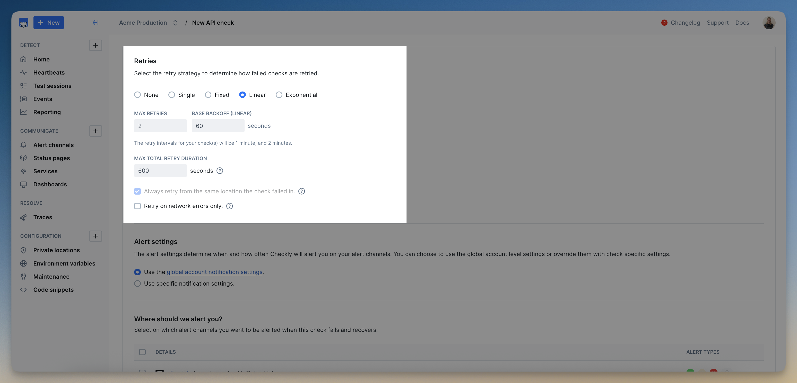

---

title: 'Alert Retries'
description: "Use retries to guard against flaky failures and alert fatigue, choosing between scheduled retry strategies for checks, check groups, and test sessions."
sidebarTitle: 'Retries'
canonical: 'https://www.checklyhq.com/docs/communicate/alerts/retries/'
---

<Tip>
**Monitoring as Code**: Learn more about [the retry strategies construct](/constructs/retry-strategy).
</Tip>

Sometimes the internet is flaky, or your app is just having a hiccup not worth pinging your on-call team about. Retries are your first line of defense against these types of false positives, leading to alert fatigue.

Whether you need to retry a check or a test session, there are different retries available.

<Warning>
Use **Retries** instead of the deprecated "double check" option.
</Warning>

## Check retry strategies

All check types and check groups, except for Heartbeat monitors, have a **Retries & Alerting** section available, where you can define the number of retries and which retry strategy your check or check group uses.

Click **Edit check** or **Edit group** on the 3-dot menu on your [Checkly Home page](https://app.checklyhq.com/) and select the **Retries & Alerting** tab:



### Scheduled check retries

There are four retry strategies based on the time between retry attempts, and each one comes with different retry/backoff characteristics.

- **Single** — retry once after a fixed interval, e.g. 5s.
- **Fixed** — a fixed time between retries, e.g. 5s, 5s, 5s etc.
- **Linear** — a linearly increasing time between retries, e.g. 5s, 10s, 15s etc.
- **Exponential** — an exponentially increasing time between retries, e.g. 5s, 25s, 125s (2m and 5s)  etc.

For uptime monitors, the strategies you can use depend on your [plan](https://www.checklyhq.com/pricing/): **Fixed**, **Linear** and **Exponential** aren't available on every plan. See [Retries on uptime monitors](#retries-on-uptime-monitors).

On top of the time between attempts, you can also set:

- **maximum number of retries** - the maximum number of retries for this check or check group.
- **maximum total retry duration** - the maximum time a check can be in a retrying state.
This is a timeout to ensure the check finishes on a timely manner.

> Make sure to include the time your check needs to run when setting the **maximum total retry duration**. For example, if you set a maximum to 2 minutes, and your check takes 1.5 minutes, you have 30 seconds left for retries.

#### How often should I retry?

**For checks that run on lower frequencies**, e.g. once per hour, it makes sense to pick a strategy that retries more often, over longer stretches of time. Let's look at an example:

1. A check with a 1-hour frequency breaks at 13:00 CET.
2. An exponential retry strategy with 3 retries and a 5-second interval is configured.
3. This generates retries spaced apart by 5 seconds, 25 seconds, 125 seconds.
4. Your check is now retried at about 13:00:05, 13:00:30 and 13:02:35.

If in that ~3-minute period your app / system recovers, and this was just a fluke, you will not be alerted. If the issue persists, Checkly will alert you as per your alert settings.

**For checks that run on higher frequencies**, e.g. once per minute, it makes sense to pick a strategy that retries less often, and spaced apart by shorter intervals.

Of course, picking the right strategy depends on your use case, tolerance for intermittent failures, SLO levels and other factors.

### Location-based check retries

You can decide if a check should be retried from the same location or not with the checkbox:
**Always retry from the same location the check failed in**
- If enabled, a check that fails will be retried in the same location.
- If disabled, a check that fails will be retried in a different location, from the locations your check runs at.

There are some tradeoffs to consider:

- Retrying from the same location makes sense if you care strongly about the uptime of your app in one specific location, compared to other locations.
- Retrying from a different location makes sense, if you want to make sure your app is up in at least one location.

### Network retries

For API checks & URL monitors, you can enable network retries to automatically retry a check run only if it fails due to a network error—such as a timeout, DNS resolution issue, or connection reset.

When network retries are enabled:
- The check will retry on: ECONNRESET, ENOTFOUND, ETIMEDOUT, EAI_AGAIN, ECONNREFUSED, and similar network errors.
- The check will not retry on: Any HTTP response that includes a status code (4xx or 5xx), failed assertions, or any other type of check failure.

### Retries on uptime monitors

The retry strategies an uptime monitor (URL, TCP, DNS, ICMP, SSL, gRPC and traceroute) can use depend on your [plan](https://www.checklyhq.com/pricing/):

| Plan | Retry strategies for uptime monitors |
|------|--------------------------------------|
| Hobby, Starter, Team and trials | **None**, **Single** |
| Enterprise | **None**, **Single**, **Fixed**, **Linear**, **Exponential** |

This limit applies to uptime monitors only: API checks can use every retry strategy on these plans. Heartbeat monitors don't retry, so they ignore any retry strategy you send for them.

For one retry, use **Single**. **Fixed**, **Linear** and **Exponential** need the Enterprise plan even when you set the maximum number of retries to 1.

When you pick a strategy your plan doesn't include:

- In the web app, the URL, TCP, DNS, ICMP and gRPC monitor forms grey out **Fixed**, **Linear** and **Exponential**. A monitor that already uses one of them shows "This retry strategy is not available on your current plan. Adjust setting or upgrade." You can't save it until you pick **None** or **Single**.
- The API answers `402 Payment Required` with this message, and `npx checkly deploy` fails with it. `npx checkly deploy --preview` reports it too, before anything is deployed.

```text wrap
The unlimited retry strategy isn’t supported on your plan. Upgrade to enable, or contact support if you have questions. Your plan supports no retries (retryStrategy: null) or a single retry (SINGLE_RETRY).
```

"Unlimited" in this message means any of **Fixed**, **Linear** or **Exponential**, whatever the number of retries.

With the Terraform provider, `terraform apply` fails with `unexpected response status 402:` followed by the API response that contains this message. `terraform plan` doesn't report it.

**Monitors that already use such a strategy** keep running, and their failed runs are still retried with that strategy. You can't change them until you switch them to **None** or **Single**: every update is rejected with the message above, even one that only renames or deactivates the monitor.

**Groups:** a group's retry override applies to every check in the group, uptime monitors included. On the Hobby, Starter and Team plans:

- You can't set a **Fixed**, **Linear** or **Exponential** override on a group that contains an uptime monitor. The web app shows "One or more monitors in your group don’t support this retry strategy. Adjust the setting or remove those monitors to continue."
- You can't add an uptime monitor to a group that has such an override.

To fix this, set the group's override to **None** or **Single**, turn off **Group override for retries** so each check keeps its own strategy, or keep uptime monitors in a separate group. See also [mixing checks and monitors in a group](/platform/groups#mixing-checks-and-monitors-in-a-group).

**Monitoring as Code:** a `retryStrategy` in the `checks` section of your `checkly.config.ts` also applies to every monitor that doesn't set its own. Set `RetryStrategyBuilder.singleRetry()` or `RetryStrategyBuilder.noRetries()` on those monitors. See the [retry strategy construct](/constructs/retry-strategy#default-retry-strategy).

## Test sessions retries

Sporadically failing tests may be caused by a variety of reasons such as issues with the underlying infrastructure, and sometimes, simply re-running the test is enough to make it succeed again.

Use retries to reduce noise in your [test session results](/detect/testing/overview) while providing information about the retry attempts.


Specify the number of retries between 0 and 3 that you’d like Checkly to attempt when running `npx checkly test` or `npx checkly trigger`.

The default number of retries is 0.

You can configure the number of test session retries as a global setting in your Checkly configuration file:

```bash
# Checkly configuration file
cli: {
    retries: 2,
}
```

Using the CLI and the `--retries=` flag takes precedence over your Checkly configuration file.

```bash
# retry npx checkly test twice
npx checkly test --retries=2

# retry npx checkly trigger 3 times
npx checkly trigger --retries=3
```

All retry attempts are be visible on the web interface at Checkly and in your command line as they’re happening:

```bash
1 retrying, 5 passed, 6 total
```

### Test session retries in your CI/CD pipeline
Use the ``--reporter=ci`` flag to run test session retries from your CI/CD pipeline. The `ci` reporter will print out all retry attempts in the prompt output, instead of live-updating the prompt.

For example:

```bash
npx checkly test --retries=2 --reporter=ci
```
