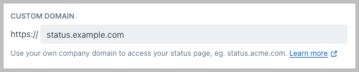
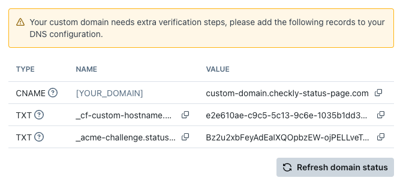

You can host your status page on your own domain. To set it up, add the domain in Checkly and create the required DNS records with your DNS provider. Checkly then issues a TLS certificate for your domain and renews it automatically.

<Note>
  Custom domains are available on Communicate Starter, Team and Enterprise
  plans. [View pricing](https://checklyhq.com/pricing)
</Note>

<Steps>
<Step title="Add a custom domain to your status page">

Save your status page. Checkly then lists the DNS records your domain needs below the custom domain field.
</Step>

<Step title="Create a CNAME record that points to `custom-domain.checkly-status-page.com`">
  Create a CNAME record with your DNS provider and point it to
  `custom-domain.checkly-status-page.com` For example, in Cloudflare, the
  configuration looks like this: 
  If your provider is Cloudflare, you must disable the proxy on the CNAME, it
  should always be set to DNS only.
</Step>

<Step title="Add TXT records if Checkly shows them">
New domains are validated over HTTP, so the CNAME record is usually all you need. If Checkly shows TXT records for your domain, add them to your DNS configuration as well.

Select **Refresh domain status** to check your setup. Once your DNS is set up, issuing the certificate usually takes a few minutes. A green check next to the custom domain field means your domain is verified.
</Step>
</Steps>

## Certificate renewal and troubleshooting

Checkly renews the certificate for your custom domain automatically. Domains validated over HTTP need no DNS changes to renew, as long as the CNAME record keeps pointing to `custom-domain.checkly-status-page.com`. Don't remove or change that record while the status page uses your domain. If your domain was set up with TXT records and Checkly shows new TXT records, add them, then select **Refresh domain status**.

If your domain has CAA records, they must allow the certificate authority named in the error message in Checkly.

If something goes wrong, the status page settings show one of these messages below the custom domain field:

| Message | What to do |
|---------|------------|
| "Certificate validation failed: …" | The certificate couldn't be validated. Fix the reason given in the message, then select **Refresh domain status**. |
| "Your domain's CAA records do not allow our certificate authority to issue a certificate." | Remove the CAA records on your domain, or add `0 issue "pki.goog; cansignhttpexchanges=yes"` alongside your existing policy. Then select **Refresh domain status**. |
| "Certificate issuance timed out for this domain." | Select **Refresh domain status** to start a new certificate order. |
| "Cloudflare has not returned the certificate validation records yet." | Wait a moment, then select **Refresh domain status** to check again. |

If refreshing doesn't help, remove the custom domain from your status page, save, then add it again and save.
