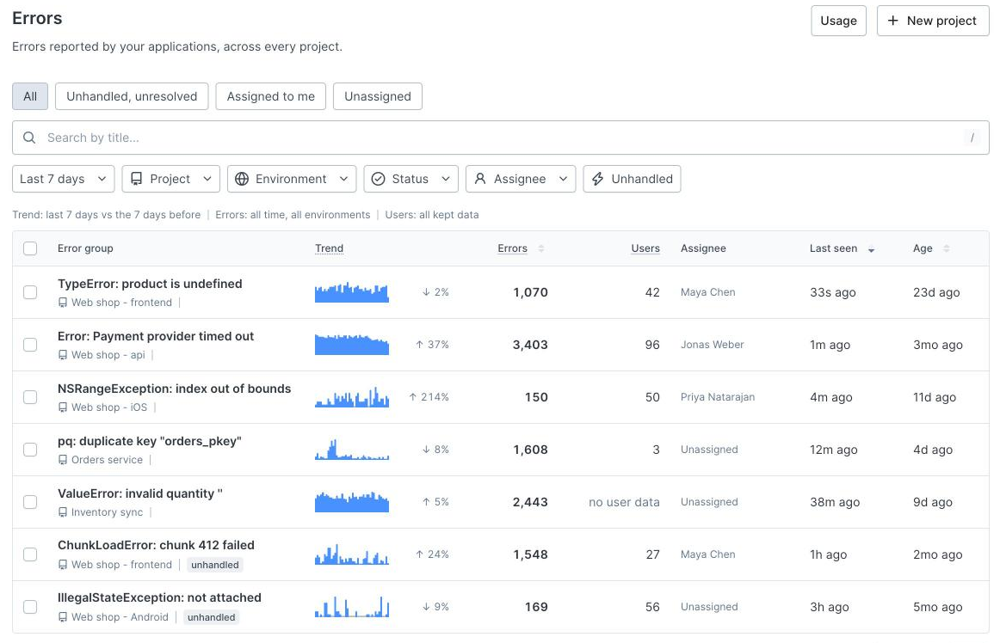

<Note>
Errors is in beta. Features and limits can change before it leaves beta.
</Note>

Errors collects the exceptions and crashes your applications report and groups them into Error Groups, with the stack trace, the breadcrumbs that led to each Error, and the release that introduced it. Checkly speaks the Sentry protocol: you install the official Sentry SDK for your platform and point its DSN at Checkly.

<Frame>
  
</Frame>

## How it works

1. You create a DSN for a Checkly project. Errors belong to the same projects your monitors and deployments use.
2. The Sentry SDK in your application sends each Error to `rum.checklyhq.com`.
3. Checkly removes secrets such as auth headers, cookies and card numbers before it stores anything. See [Data and limits](/detect/errors/data-and-limits).
4. Checkly groups Errors with the same cause into one Error Group. If you upload source maps or debug files, stack traces are shown as your original code, and a new build of the same minified code joins the existing Error Group. See [Error Groups](/detect/errors/error-groups).
5. You triage Error Groups on the **Errors** page: resolve, ignore, assign, merge or split them. A resolved Error Group that receives a new Error reopens as a regression.

Checkly keeps each Error for 30 days. An Error Group keeps its status, assignee and first and last seen dates after its Errors expire.

## Errors and Checkly checks

When your application reports an Error during a Checkly check run, its Error Group shows which check run it was seen in, with links to the check and to the backend trace.

## Get started

- [Send Errors to Checkly](/detect/errors/send-errors): get a DSN, install the SDK and see the first Error arrive.
- [Move from Sentry](/detect/errors/move-from-sentry): switch an application that already uses Sentry to Checkly.
- [Frameworks](/detect/errors/frameworks): the setup for Next.js, React, Express, Django, Laravel, Rails, Spring Boot and ASP.NET Core.
- [Upload source maps and debug files](/detect/errors/source-maps): readable stack traces for minified JavaScript and native apps.
- [Error Groups](/detect/errors/error-groups): how grouping works and how to triage.
- [Data and limits](/detect/errors/data-and-limits): what Checkly stores, for how long, and the ingest limits.
- [API and MCP](/detect/errors/api): read and triage Error Groups from scripts and AI agents.
