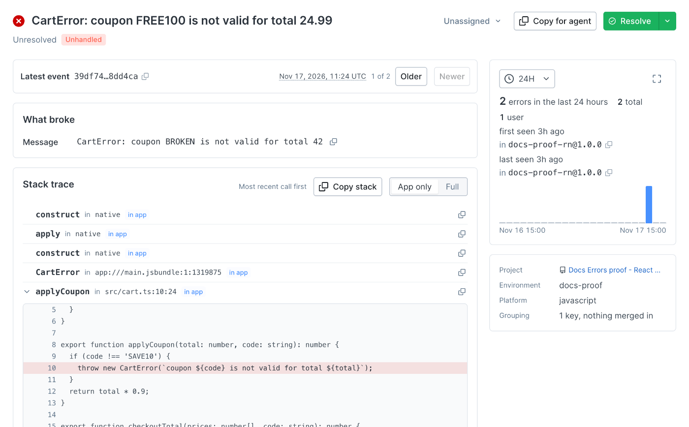

Minified JavaScript and native release builds produce stack traces that are hard to read. Upload the matching source maps or debug files with `sentry-cli`, and Checkly shows every stack frame as your original file, function and line. A new build of the same code then also joins its existing error group instead of opening a new one.

<Frame>
  
</Frame>

You need:

- `sentry-cli` 2.58 or later, or 3.x.
- A Checkly user API key, which starts with `cu_`, with the `projects:deploy` permission, or a service API key of the account, which starts with `sv_`. Account API keys are not accepted. See [Creating an API key](/admin/creating-api-key).

## Configure sentry-cli

Set these environment variables, or the matching `sentry-cli` options:

| Variable | Value |
|---|---|
| `SENTRY_URL` | `https://rum.checklyhq.com` |
| `SENTRY_ORG` | Your Checkly account ID |
| `SENTRY_PROJECT` | The Checkly project ID or logical ID |
| `SENTRY_AUTH_TOKEN` | Your user or service API key |

Set `SENTRY_URL` in the same place as `SENTRY_AUTH_TOKEN`: both as environment variables, or both in `sentry.properties`. If the token comes from the environment and the URL only from the file, `sentry-cli` 3.x ignores the URL and sends the upload, with your key, to sentry.io.

Upload to one project at a time. Run `sentry-cli` once per project.

## Upload JavaScript source maps

Checkly matches source maps to frames by debug ID. Inject debug IDs into your build output, deploy those files, and upload the source maps with the release your SDK sends:

```bash Terminal
sentry-cli sourcemaps inject ./dist
sentry-cli sourcemaps upload --release storefront@2026.9.3 ./dist
```

The upload prints a report of the files it sent:

```text Terminal
...
> Bundled 2 files for upload
...
> File upload complete (processing pending on server)
> Organization: <your-account-id>
> Projects: docs-errors-proof
> Release: storefront@2026.9.3
> Dist: None
> Upload type: artifact bundle

Source Map Upload Report
  Scripts
    ~/main.js (sourcemap at main.js.map, debug id 8faf8c03-3a67-5ee5-9a07-9fdf96240e15)
  Source Maps
    ~/main.js.map (debug id 8faf8c03-3a67-5ee5-9a07-9fdf96240e15)
```

Deploy the files from `./dist` after `inject`, because `inject` changes them. If an error has no debug IDs, its error group says so and the frames stay minified.

## Upload native debug files and ProGuard mappings

Upload the debug files of the build you ship. Checkly matches them to frames by debug ID or ProGuard UUID, so the release does not have to match.

**iOS and macOS:** build with `DEBUG_INFORMATION_FORMAT` set to `dwarf-with-dsym`, and upload the dSYM:

```bash Terminal
sentry-cli debug-files upload ./build/MyApp.app.dSYM
```

**Android with R8 or ProGuard:** give each release build a new UUID, and write it to `app/src/main/assets/sentry-debug-meta.properties` so the SDK sends it with every error:

```properties sentry-debug-meta.properties
io.sentry.ProguardUuids=<proguard-uuid>
```

Then upload the build's mapping file with the same UUID:

```bash Terminal
sentry-cli upload-proguard --uuid <proguard-uuid> app/build/outputs/mapping/release/mapping.txt
```

Keep line numbers in the build with `-keepattributes SourceFile,LineNumberTable` in your ProGuard rules. Frames of classes R8 inlined are expanded to the original methods.

With `sentry-cli` 2.x, set `SENTRY_EXPERIMENTAL_PROGUARD_CHUNK_UPLOAD=1` for ProGuard uploads, or use `sentry-cli` 3.x. Checkly accepts ProGuard mappings only in chunks.

**Android NDK:** upload the unstripped libraries. The APK contains only stripped ones:

```bash Terminal
sentry-cli debug-files upload app/build/intermediates/merged_native_libs/release/mergeReleaseNativeLibs/out/lib/arm64-v8a/
```

**C and C++ with the Native SDK on macOS:** build `sentry-native` with `-DSENTRY_BACKEND=inproc` and upload the dSYM of your binary, as for Apple apps above. Checkly does not accept minidumps, so crashes from the default `crashpad` backend and from the `breakpad` backend do not arrive.

**Breakpad symbols:** upload `.sym` files, for example created with Mozilla `dump_syms`:

```bash Terminal
sentry-cli debug-files upload app.sym
```

**React Native:** the Sentry React Native SDK uploads the Hermes source map during the release build, with a debug ID. Wrap your Metro config with `withSentryConfig` in `metro.config.js`. On iOS, wrap the **Bundle React Native code and images** build phase with `sentry-xcode.sh` and put `sentry.properties` in `ios/`. On Android, add `apply from: "../../node_modules/@sentry/react-native/sentry.gradle"` to `android/app/build.gradle` and put `sentry.properties` in `android/`. Both files hold the same values:

```properties sentry.properties
defaults.url=https://rum.checklyhq.com
defaults.org=<your-account-id>
defaults.project=<project-logical-id>
```

Set the key as described in [Configure sentry-cli](#configure-sentry-cli): `SENTRY_URL` and `SENTRY_AUTH_TOKEN` in the build environment, or `auth.token` in this file. Native crashes need the dSYM or NDK uploads above as well: the Android build step uploads only the source map.

## Supported files

| File | Supported |
|---|---|
| JavaScript source maps | Yes |
| Mach-O and dSYM (Apple platforms) | Yes |
| ELF (Linux, Android NDK) | Yes |
| ProGuard and R8 mappings | Yes |
| Breakpad symbols (`.sym`) | Yes |
| Source bundles (`--include-sources`) | No. Checkly accepts the upload but does not show the source lines. |
| Minidumps | No |
| Windows PDB and .NET portable PDB | No |
| Unity IL2CPP and Flutter or Dart symbols | No |

Each file can be up to 2 GiB.

Checkly symbolicates in the background. A new error can show minified or raw frames for up to about a minute before its original frames appear.

## Check your uploads

A project's **Releases** page lists each release with the source maps and debug files uploaded for it, and the state of each upload: **Waiting**, **Processing**, **Stored** or **Failed**. A failed upload shows its reason, such as **File too large** or **Malformed file**.

Open an upload to see the lookup file of each debug ID, which Checkly reads to resolve frames. **Available** means it exists, and **Build failed** shows the reason next to it. A source bundle shows **Not used**: Checkly keeps it but does not show source lines from it.

On an error group, frames that could not be resolved show why: **No source map uploaded**, **Source map failed to process** or **Lookup file not found**.

### Upload after the error

You can upload the files after the errors arrived. If an error with the same stack trace arrived in the last 24 hours, Checkly shows it and every earlier error with that stack trace as your original code within about a minute. Otherwise this happens when the stack trace occurs again. A late upload changes only how errors are shown: it does not regroup them.

## Troubleshooting

`sentry-cli` prints the reason when Checkly refuses an upload:

| Message | Fix |
|---|---|
| `The organization must be your Checkly account ID (a UUID)` | Set `SENTRY_ORG` to your account ID, not its name. |
| `Set SENTRY_PROJECT, or --project, to the Checkly project ID or logical ID.` | Set the project. |
| `Account API keys are not accepted here.` | Use a user API key or a service API key. |
| `This API key may not upload debug files to this account.` | Give the user a role with `projects:deploy`, or use a service API key of this account. |
| `Uploading ProGuard mappings in one request is not available yet.` | Use `sentry-cli` 3.x, or set `SENTRY_EXPERIMENTAL_PROGUARD_CHUNK_UPLOAD=1`. |
