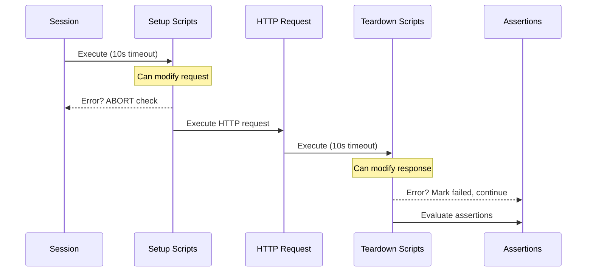

import GenericRuntimeVariablesTable from '/snippets/generic-runtime-variables-table.mdx';
import { YoutubeEmbed } from "/snippets/youtube-embed.jsx"

Setup and teardown scripts execute arbitrary JavaScript/TypeScript code before and after an API check's HTTP request.
Both script types have access to environment variables, runtime objects like `request` and `response`, and popular npm packages
like `moment`, `axios`, and `lodash`.

To get the most power out of API checks with setup and teardown scripts, we advise using [the Checkly CLI](/cli/overview).
You can also use them [via the web UI](#using-setup-and-teardown-scripts-via-the-ui).

> Setup and teardown scripts have a **maximum execution time of 10 seconds** each.

Check the video below for a quick overview of using setup and teardown scripts through the web UI and with the CLI.

<YoutubeEmbed id="38ZXJy-nlvI" title="Monitor complex API endpoints with Checkly API checks" />

## How it works

Setup and teardown scripts run at specific points in the API check lifecycle. Understanding this flow helps you use them effectively.



**Execution order:**

1. Setup scripts run first and can modify the request before it's sent.
2. The HTTP request executes.
3. Teardown scripts run and can access or modify the response.
4. Assertions evaluate against the (possibly modified) response.

## Setup scripts

Setup scripts execute before the HTTP request. Use them to prepare test data, configure request parameters, and handle authentication.

You have access to [built-in variables](#built-in-variables) to modify the HTTP request and a set of [libraries available in each runtime](/platform/runtimes/runtime-specification).

### Modifying the request

You can modify any property of the `request` object:

```ts
// Set a custom header
request.headers['X-Custom-Header'] = 'my value'

// Append a value to the request URL
request.url = request.url + '/extra'

// Set query parameters
request.queryParameters['filter'] = 'active'

// Modify the request body
request.body = JSON.stringify({ userId: 123 })

// Change the HTTP method
request.method = 'POST'
```

### Authentication example

A common task for setup scripts is fetching or signing session tokens. You can centralize this logic and reuse it across API checks.

1. Create an API check and reference the setup script (`setup.ts`) using the `entrypoint` property.
2. Encapsulate authentication logic in a separate `auth-client.ts` file.
3. In the `setup.ts` file, import the auth client and update the `request` object.

Your folder structure:

```
.
|-- api-1.check.ts
|-- setup.ts
`-- common
    `-- auth-client.ts
```

The API check performs a `GET` on an authenticated endpoint:

```ts api.check.ts
import { ApiCheck } from 'checkly/constructs'
import * as path from 'path'

new ApiCheck('api-check-1', {
    name: 'Fetch Product Data',
    setupScript: {
        entrypoint: path.join(__dirname, 'setup.ts'),
    },
    request: {
        method: 'GET',
        url: 'https://api.acme.com/v1/products'
    }
})
```

The setup script uses the auth client and sets the `Authorization` header:

```ts setup.ts
import { getToken } from './common/auth-client'
const token = await getToken()
request.headers['Authorization'] = `Bearer ${token}`
```

The auth client reads a static environment variable for authentication:

```ts common/auth-client.ts
import axios from 'axios'

export async function getToken () {
    console.log('Fetching session token from auth server')
    const { data } = await axios.get('https://api.checklyhq.com/v1/runtimes', {
        headers: {
            authorization: process.env.AUTH_SERVER_TOKEN
        }
    })
    return data.token
}
```

Benefits of this structure:

- Reuse authentication logic across multiple API checks
- Test authentication logic separately from Checkly-specific code

See the [setup script examples](#setup-script-examples) for fetching tokens, OAuth2, HMAC signing and JWTs, and the [setup scripts guide](/guides/setup-scripts-for-apis) for more patterns.

### Error handling in setup scripts

If a setup script throws an error or times out, the check **aborts immediately**. The HTTP request never executes, and assertions don't run.

```ts
// This error will abort the check
if (!process.env.API_KEY) {
  throw new Error('API_KEY environment variable is required')
}
```

## Teardown scripts

Teardown scripts run after the HTTP request completes but before assertions evaluate. They have access to both the `request` and `response` objects.

Common use cases:

- Cleaning up test data created during the check
- Scrubbing sensitive data from responses before logging
- Normalizing response data for consistent assertions

### Accessing the response

The `response` object contains the full HTTP response:

```ts
// Log response details
console.log('Status:', response.statusCode)
console.log('Headers:', JSON.stringify(response.headers))

// Parse JSON body
const body = JSON.parse(response.body)
console.log('User ID:', body.userId)
```

### Modifying the response

You can modify response properties before assertions run. This is useful for scrubbing sensitive data or normalizing inconsistent API responses.

```ts
// Scrubbing sensitive data before logging
const body = JSON.parse(response.body)

if (body.user) {
  body.user.ssn = '[REDACTED]'
  body.user.creditCard = '[REDACTED]'
}

response.body = JSON.stringify(body)
```

```ts
// Normalizing timestamps for consistent assertions
const body = JSON.parse(response.body)

// Replace dynamic timestamps with a static value
body.createdAt = '2024-01-01T00:00:00Z'
body.updatedAt = '2024-01-01T00:00:00Z'

response.body = JSON.stringify(body)
```

### Cleaning up test data

If your setup script creates test data, use the teardown script to clean it up:

```ts
// Delete the test user created in setup
const testUserId = process.env.TEST_USER_ID

if (testUserId) {
  const axios = require('axios')
  await axios.delete(`https://api.acme.com/users/${testUserId}`, {
    headers: { Authorization: `Bearer ${process.env.API_KEY}` }
  })
  console.log('Cleaned up test user:', testUserId)
}
```

### Error handling in teardown scripts

Unlike setup scripts, teardown errors **do not abort** the check. The check continues and assertions still evaluate. However, if an error occurs, it may mark the check as failed depending on the error type.

| Aspect | Setup Scripts | Teardown Scripts |
|--------|--------------|------------------|
| On error | Check **aborts** immediately | Check **continues** |
| HTTP request | Never executes | Already completed |
| Assertions | Never run | Still evaluate |

## Setup script examples

These examples cover common authentication cases.

### Fetch an external token

<CodeGroup>
```ts TypeScript
import axios from 'axios'

// use 'await' on an axios HTTP get to fetch a token from a location
const { data } = await axios.get('http://host.docker.internal:9913/api/token')

// add the token as a query parameters
request.queryParameters['token'] = data.token
```
```js JavaScript
const axios = require('axios')

// use 'await' on an axios HTTP get to fetch a token from a location
const { data } = await axios.get('http://host.docker.internal:9913/api/token')

// add the token as a query parameters
request.queryParameters['token'] = data.token
```
</CodeGroup>

### Sign an HMAC request

<CodeGroup>
```ts TypeScript
import CryptoJS from 'crypto-js'
import moment from 'moment'

// get keys stored in environment variables
const privateKey = process.env.PRIVATE_KEY
const publicKey = process.env.PUBLIC_KEY

// collect the fields used in signing the request
const method = request.method
const contentType = 'application/json'
const contentMd5 = ''
const url = request.url
const host = 'localhost:8080'
const uri = url.replace(/^.*\/\/[^\/]+/, '')
const timestamp = moment().toISOString()

// create the signature
const signature = [method, contentMd5, contentType, timestamp].join(',\n')
const encryptedSignature = publicKey + ':' + CryptoJS.HmacSHA1(signature, privateKey).toString(CryptoJS.enc.Base64)

// set or update the results as environment variables, to be used in the HTTP request.
process.env.TIMESTAMP = timestamp
process.env.ENCRYPTED_SIGNATURE = encryptedSignature
process.env.CONTENT_TYPE = contentType
```
```js JavaScript
const CryptoJS = require('crypto-js')
const moment = require('moment')

// get keys stored in environment variables
const privateKey = process.env.PRIVATE_KEY
const publicKey = process.env.PUBLIC_KEY

// collect the fields used in signing the request
const method = request.method
const contentType = 'application/json'
const contentMd5 = ''
const url = request.url
const host = 'localhost:8080'
const uri = url.replace(/^.*\/\/[^\/]+/, '')
const timestamp = moment().toISOString()

// create the signature
const signature = [method, contentMd5, contentType, timestamp].join(',\n')
const encryptedSignature = publicKey + ':' + CryptoJS.HmacSHA1(signature, privateKey).toString(CryptoJS.enc.Base64)

// set or update the results as environment variables, to be used in the HTTP request.
process.env.TIMESTAMP = timestamp
process.env.ENCRYPTED_SIGNATURE = encryptedSignature
process.env.CONTENT_TYPE = contentType
```
</CodeGroup>

### Fetch an OAuth2 access token using the `client_credentials` grant

This works for OAuth2 providers like Okta and Auth0 that support the `client_credentials` grant type.

<CodeGroup>
```ts TypeScript
import axios from 'axios'

// grab the necessary credentials set up earlier in your environment variables.
const { AUDIENCE, CLIENT_SECRET, CLIENT_ID, ISSUER } = process.env;

// fetch an access token
const { data: { access_token } } = await axios.post(`${ISSUER}/oauth/token`,
    {
      grant_type: "client_credentials",
      client_id: `${CLIENT_ID}`,
      client_secret: `${CLIENT_SECRET}`,
      audience: `${AUDIENCE}`,
    },
    {
      headers: { "content-type": "application/x-www-form-urlencoded" }
    }
)

// set the Authorization header
request.headers['Authorization'] = `Bearer ${access_token}`
```
```js JavaScript
const axios = require('axios')

// grab the necessary credentials set up earlier in your environment variables.
const { AUDIENCE, CLIENT_SECRET, CLIENT_ID, ISSUER } = process.env;

// fetch an access token
const { data: { access_token } } = await axios.post(`${ISSUER}/oauth/token`,
  {
    grant_type: "client_credentials",
    client_id: `${CLIENT_ID}`,
    client_secret: `${CLIENT_SECRET}`,
    audience: `${AUDIENCE}`,
  },
  {
    headers: { "content-type": "application/x-www-form-urlencoded" }
  }
)

// set the Authorization header
request.headers['Authorization'] = `Bearer ${access_token}`
```
</CodeGroup>

### Fetch an OAuth2 access token using the `password` grant

This works for OAuth2 providers like Okta and Auth0 that support the `password` grant type.

<CodeGroup>
```ts TypeScript
import axios from "axios";

// grab the necessary credentials set up earlier in your environment variables.
const { AUDIENCE, CLIENT_SECRET, CLIENT_ID, ISSUER, USERNAME, PASSWORD, SCOPE } = process.env;

// fetch an access token
const { data: { access_token } } = await axios.post(`${ISSUER}/oauth/token`,
    {
        grant_type: 'password',
        username: `${USERNAME}`,
        password: `${PASSWORD}`,
        audience: `${AUDIENCE}`,
        scope: `${SCOPE}`,
        client_id: `${CLIENT_ID}`,
        client_secret: `${CLIENT_SECRET}`
    },
    {
        headers: { "content-type": "application/x-www-form-urlencoded" }
    }
)

// set the Authorization header
request.headers['Authorization'] = `Bearer ${access_token}`
```
```js JavaScript
const axios = require('axios')

// grab the necessary credentials set up earlier in your environment variables.
const { AUDIENCE, CLIENT_SECRET, CLIENT_ID, ISSUER, USERNAME, PASSWORD, SCOPE } = process.env;

// fetch an access token
const { data: { access_token } } = await axios.post(`${ISSUER}/oauth/token`,
    {
      grant_type: 'password',
      username: `${USERNAME}`,
      password: `${PASSWORD}`,
      audience: `${AUDIENCE}`,
      scope: `${SCOPE}`,
      client_id: `${CLIENT_ID}`,
      client_secret: `${CLIENT_SECRET}`
    },
    {
        headers: { "content-type": "application/x-www-form-urlencoded" }
    }
)

// set the Authorization header
request.headers['Authorization'] = `Bearer ${access_token}`
```
</CodeGroup>

### Create a JWT token using the jsonwebtoken library

<CodeGroup>
```ts TypeScript
// we use the jsonwebtoken library as it makes creating JTW's really easy
import jwt from 'jsonwebtoken'

// grab the secret from our environment variables
const secret = process.env.SECRET

// define a helper function to sign the token
const getToken = () => {
    return new Promise((resolve, reject) => {
        jwt.sign({
            expiry: Math.floor(Date.now() / 1000) + (60 * 60), // set the expiry time to 60 minutes
            email: '',
            userId: '',
        }, secret , (err, token) => {
            if(err) return reject(err);
            resolve(token);
        });
    })
}

// create the token
const token = await getToken();

// set the Authorization header
request.headers['Authorization'] = `Bearer ${token}`
```
```js JavaScript
// we use the jsonwebtoken library as it makes creating JTW's really easy
const jwt = require('jsonwebtoken');

// grab the secret from our environment variables
const secret = process.env.SECRET

// define a helper function to sign the token
const getToken = () => {
  return new Promise((resolve, reject) => {
    jwt.sign({
      expiry: Math.floor(Date.now() / 1000) + (60 * 60), // set the expiry time to 60 minutes
      email: '',
      userId: '',
    }, secret , (err, token) => {
      if(err) return reject(err);
      resolve(token);
    });
  })
}

// create the token
const token = await getToken();

// set the Authorization header
request.headers['Authorization'] = `Bearer ${token}`
```
</CodeGroup>

### Parse XML/SOAP data

To prepare a SOAP API check, fetch the API data, parse the XML and store the value in an environment variable so you can use it in the request body.

<CodeGroup>
```ts TypeScript
import axios from 'axios'

// Make an XML request
const { data } = await axios.post(
    "https://www.dataaccess.com/webservicesserver/NumberConversion.wso",
    `<?xml version="1.0" encoding="utf-8"?>
      <soap:Envelope xmlns:soap="http://schemas.xmlsoap.org/soap/envelope/">
        <soap:Body>
          <NumberToWords xmlns="http://www.dataaccess.com/webservicesserver/">
            <ubiNum>42</ubiNum>
          </NumberToWords>
        </soap:Body>
    </soap:Envelope>
  `,
    {
        headers: {
            "content-type": "text/xml; charset=utf-8",
        },
    }
)

// Parse the value you're interested in
const regExp = /<m:NumberToWordsResult>(.*?)<\/m:NumberToWordsResult>/g
const result = regExp.exec(data)

if (result.length > 1) {
    // Store it in an environment variable to access it in your API Check request body
    process.env.NUMBER_TO_WORD_RESULT = result[1]
} else {
    throw new Error("Could not parse XML")
}
```
```js JavaScript
const axios = require('axios').default

// Make an XML request
const { data } = await axios.post(
  "https://www.dataaccess.com/webservicesserver/NumberConversion.wso",
  `<?xml version="1.0" encoding="utf-8"?>
      <soap:Envelope xmlns:soap="http://schemas.xmlsoap.org/soap/envelope/">
        <soap:Body>
          <NumberToWords xmlns="http://www.dataaccess.com/webservicesserver/">
            <ubiNum>42</ubiNum>
          </NumberToWords>
        </soap:Body>
    </soap:Envelope>
  `,
  {
    headers: {
      "content-type": "text/xml; charset=utf-8",
    },
  }
)

// Parse the value you're interested in
const regExp = /<m:NumberToWordsResult>(.*?)<\/m:NumberToWordsResult>/g
const result = regExp.exec(data)

if (result.length > 1) {
  // Store it in an environment variable to access it in your API Check request body
  process.env.NUMBER_TO_WORD_RESULT = result[1]
} else {
  throw new Error("Could not parse XML")
}
```
</CodeGroup>

## Teardown script examples

### Update response status

<CodeGroup>
```ts TypeScript
response.statusCode = 201
```
```js JavaScript
response.statusCode = 201
```
</CodeGroup>

### Perform additional assertions

You can run additional assertions in your teardown script, for example when the main assertions of the API check aren't fine-grained enough.

<CodeGroup>
```ts TypeScript
import { expect } from 'expect'
expect(response.body).toBe('myString')
```
```js JavaScript
const { expect } = require('expect')
expect(response.body).toBe('myString')
```
</CodeGroup>

Or assert against a dynamic value, such as a timestamp in the response that should match today's date:

<CodeGroup>
```ts TypeScript
import { expect } from 'expect'
import moment from 'moment'

const currentDate = moment().format('llll')
expect(JSON.parse(response.body).date).toBe(currentDate)
```
```js JavaScript
const { expect } = require('expect')
const moment = require('moment')

const currentDate = moment().format('llll')
expect(JSON.parse(response.body).date).toBe(currentDate)
```
</CodeGroup>

### Delete created test data based on response

This script runs after an API check that POSTs a JSON blob to the Checkly API to create a check. It reads the ID of the created check from the response and deletes the check again. The credentials come from environment variables.

<CodeGroup>
```ts TypeScript
// explicitly import axios
import axios from 'axios'

// parse the created resource
const createdResource = JSON.parse(response.body)

// setup the correct url and its parameters
const host = 'https://api.checklyhq.com'
const path = '/v1/checks/' + createdResource.id

// set the correct auth headers
const headers = {
    'Authorization': 'Bearer ' + process.env.API_BEARER,
    'X-Checkly-Account': process.env.CHECKLY_ACCOUNT_ID
}

// delete the just created resource using the axios HTTP client
await axios.delete(host + path, { headers })
```
```js JavaScript
// explicitly import axios
const axios = require('axios')

// parse the created resource
const createdResource = JSON.parse(response.body)

// setup the correct url and its parameters
const host = 'https://api.checklyhq.com'
const path = '/v1/checks/' + createdResource.id

// set the correct auth headers
const headers = {
  'Authorization': 'Bearer ' + process.env.API_BEARER,
  'X-Checkly-Account': process.env.CHECKLY_ACCOUNT_ID
}

// delete the just created resource using the axios HTTP client
await axios.delete(host + path, { headers })
```
</CodeGroup>

### Update the JSON response body

<CodeGroup>
```ts TypeScript
// Parse the body as JSON
const body = JSON.parse(response.body)

// manipulate the object
body.someKey = 1

// store it again as a JSON string
response.body = JSON.stringify(body)
```
```js JavaScript
// Parse the body as JSON
const body = JSON.parse(response.body)

// manipulate the object
body.someKey = 1

// store it again as a JSON string
response.body = JSON.stringify(body)
```
</CodeGroup>

## Built-in variables

Inside each script, you have access to specific data structures from the API check lifecycle.

### Environment variables

You have access to all environment variables configured in your account. You can create, read,
update, and delete attributes, but mutations only persist for the duration of a single check run.

The current data center location is exposed as the region code in the `REGION` constant,
e.g., `eu-west-1` or `us-east-1`.

```typescript
// Read values
const myValue = process.env.MY_KEY

// Write values
process.env.MY_KEY = myValue + 10

// Add a new key/value pair
process.env.NEW_KEY = 'new value'

// Remove a key
delete process.env.SOME_OTHER_KEY
```

In setup scripts, the modified environment object is used for the subsequent HTTP request. In teardown
scripts, modifications are only available for the remainder of that script's execution.

[More about using environment variables](/platform/variables)

### Request

Request properties are exposed as a standard JavaScript object. This object is available in both setup and teardown scripts.

| Property | Description | Type | Modifiable |
| -------- | ----------- | ---- | ---------- |
| `request.method` | The HTTP request method, e.g., 'GET', 'POST'. | String | Setup only |
| `request.url` | The request URL. Query parameters are appended. | String | Setup only |
| `request.body` | The request body in string format. | String | Setup only |
| `request.headers` | The request headers. | Object | Setup only |
| `request.queryParameters` | The request query parameters. | Object | Setup only |

### Response

Response properties are exposed as a standard JavaScript object. These are only available in teardown scripts.

| Property | Description | Type | Modifiable |
|----------|-------------|------|------------|
| `response.statusCode` | The response status code, e.g., 200 or 404. | Number | Yes |
| `response.statusMessage` | The response status text, e.g., 'Ok' or 'Not found'. | String | Yes |
| `response.body` | The response body in string format. Use `JSON.parse()` for JSON. | String | Yes |
| `response.headers` | The response headers. | Object | Yes |
| `response.timings` | Timestamps for each request stage relative to start time. | Object | No |
| `response.timingPhases` | Time durations for each request phase. | Object | Yes |

### Built-in runtime variables

The [setup and teardown runtime](/platform/runtimes/overview) exposes specific environment variables,
in addition to generic runtime variables like `process.env.CHECK_NAME`.

#### Setup & teardown specific variables

| Variable | Description |
|----------|-------------|
| `GROUP_BASE_URL` | The `{{GROUP_BASE_URL}}` value of the grouped API check. |
| `REQUEST_URL` | The request URL of the API check. |

#### Generic runtime variables

<GenericRuntimeVariablesTable/>

## Technical reference

### Included libraries

All setup and teardown scripts run in a sandboxed environment. You do not have full access to the
Node.js standard library or arbitrary npm packages.

Check [our runtimes documentation](/platform/runtimes/runtime-specification) for a full specification of included modules.

### Limitations

- Setup and teardown scripts are implicitly wrapped in an async function. You can always use `await` statements.
- You cannot use nested callbacks as there is no way to determine the callback function. Always use `await` statements.
- You need to include modules and libraries explicitly, e.g., `const moment = require('moment')`.
- You can pass a maximum of 256KB of data to and from the check's main request.

## Using setup and teardown scripts via the UI

When using the Checkly web UI, write JS/TS code directly in the setup and teardown script editors.


### Using environment variables via Handlebars

If your API check's request body relies on data from a setup script, use environment variables to pass it.

```typescript
// Define a variable in the setup script
process.env.MY_VALUE = 'my value'
```

Access environment variables in the request body with `{{MY_VALUE}}` notation.


For more examples, see the [setup scripts guide](/guides/setup-scripts-for-apis).
