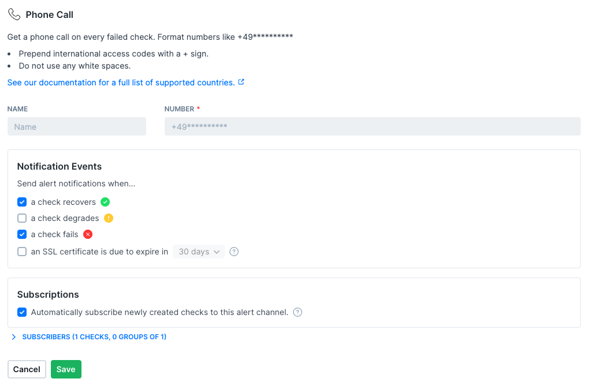

<Tip>
**Monitoring as Code**: Learn more about the [Phone Call Alert Channel Construct](/constructs/phone-call-alert-channel).
</Tip>

The phone numbers used for phone call alerting need to be in [E.164 format](https://www.twilio.com/docs/glossary/what-e164). Stick to the following rules, and you'll be fine:

- Prepend international access codes with a + sign
- Do not use any white spaces
- Use up to 15 characters

You can add as many phone number channels as you like. Phone call alerts are included on the Team plan and above. On the Hobby plan, you can't create phone call channels. On the Starter plan, you can create and test a phone call channel, but its alerts aren't sent, see [Monthly phone call quota](#monthly-phone-call-quota).

Some countries are only available on paid plans, not during a trial: the same countries as for SMS alerts. Numbers are checked the same way as for SMS alerts, see [SMS supported countries and regions](/integrations/alerts/sms#supported-countries-and-regions) for the messages. For a phone call channel, the web app shows `Calls to this country require a paid plan. Upgrade your plan to use this number.` for a paid-only country.

## Supported countries and regions

| Country |
| ------ |
| Argentina (+54)             |
| Australia (+61)             |
| Austria (+43)               |
| Belgium (+32)               |
| Brazil (+55)                |
| Bulgaria (+359)             |
| Canada (+1)                 |
| Chile (+56)                 |
| Colombia (+57)              |
| Croatia (+385)              |
| Cyprus (+357)               |
| Czech Republic (+420)       |
| Denmark (+45)               |
| Estonia (+372)              |
| Finland (+358)              |
| France (+33)                |
| Germany (+49)               |
| Greece (+30)                |
| Hong Kong (+852)            |
| Hungary (+36)               |
| Iceland (+354)              |
| India (+91)                 |
| Ireland (+353)              |
| Israel (+972)               |
| Italy (+39)                 |
| Japan (+81)                 |
| Latvia (+371)               |
| Liechtenstein (+423)        |
| Lithuania (+370)            |
| Luxembourg (+352)           |
| Malta (+356)                |
| Mexico (+52)                |
| Netherlands (+31)           |
| New Zealand (+64)           |
| Norway (+47)                |
| Paraguay (+595)             |
| Poland (+48)                |
| Portugal (+351)             |
| Romania (+40)               |
| Singapore (+65)             |
| Slovakia (+421)             |
| Slovenia (+386)             |
| South Korea (+82)           |
| Spain (+34)                 |
| Sweden (+46)                |
| Switzerland (+41)           |
| United Arab Emirates (+971) |
| United Kingdom (+44)        |
| United States (+1)          |
| Uruguay (+598)              |
| Vietnam (+84)               |

<Info>
If your country is not supported feel free to reach out to our [support team](mailto:support@checklyhq.com).
</Info>

## Phone call number and sender ID

Phone call alerts always use the following number: +18142508623. You can save the number as a contact to allow alerts bypassing any do-not-disturb settings.

## Monthly phone call quota

Each phone call alert that Checkly sends to a channel counts against your account's monthly phone call quota. All phone call channels in your account share the quota, and it starts again at the beginning of each calendar month. See the [Pricing page](https://www.checklyhq.com/pricing/#features) for the quota of each plan. Test calls don't count against the quota.

When your account has used its quota, or your plan includes no phone calls, Checkly doesn't send the call. The alert appears in the [alert notification log](/communicate/alerts/notification-log) with the delivery status **Failed** and the notification result `Account hit the monthly CALL limit`.

Accounts on a trial can send only a few test calls a day. The limit resets after 24 hours. When you reach that limit, the **Test alert channel** button shows how many seconds to wait. On every plan, you can send at most two tests a minute, counted across all alert channel types. A third test within the minute fails with **Test rate limit exceeded**.

Need more SMS or phone calls? Contact [support](mailto:support@checklyhq.com).

## Troubleshooting a missing phone call alert

Open the [alert notification log](/communicate/alerts/notification-log), select your phone call channel and check **Show failures only**. Select a failed notification to see its notification result:

- `Account hit the monthly CALL limit`: your account used its monthly phone call quota, or your plan includes no phone calls. See [Monthly phone call quota](#monthly-phone-call-quota).
- `Incomplete alert channel config`: the channel has no phone number. Edit the channel and add one.
- `Failed to send the Call`: the call couldn't be started through our phone call provider. Check that the number is correct, then select **Test alert channel** to place a test call. If alerts to a correct number keep failing, contact [support](mailto:support@checklyhq.com).

<Note>For limits and other phone call related questions, please refer to our [Pricing page](https://www.checklyhq.com/pricing/#features).</Note>
