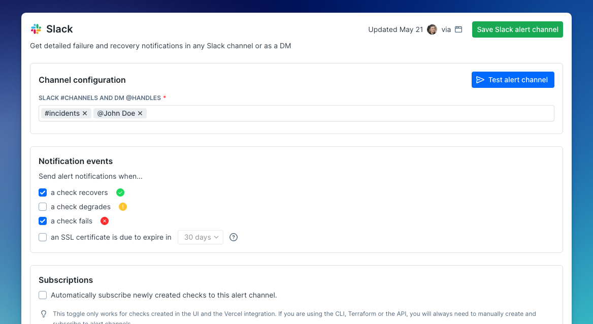
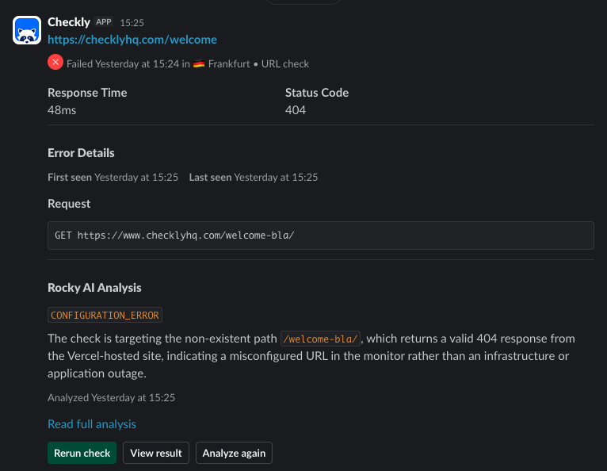
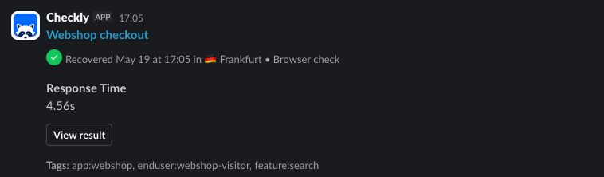
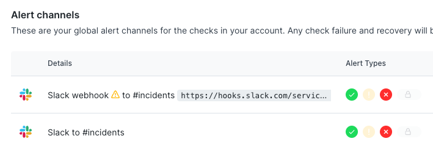
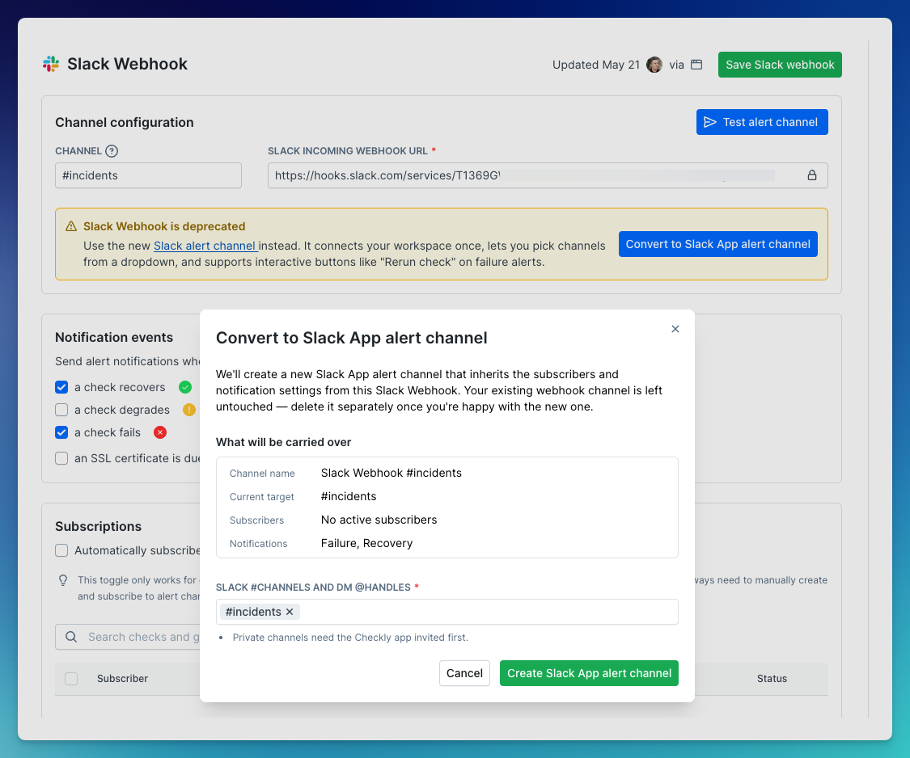

Setting up Slack as an alerting channel is simple:

1. First, install the Checkly Slack App into your Slack Workspace by going to [your integrations page](https://app.checklyhq.com/accounts/settings/account/integrations) and click **Connect Slack workspace**.
2. Then, head to [your alert settings](https://app.checklyhq.com/accounts/alerts/settings), click "Add more channels" and select a new Slack channel.

You can add any **#public-channel-name**, a **channel ID** such as `C0123456789`, or **@username** for Direct Messages. Each entry must start with `#` or `@`, or be a channel ID. A channel ID keeps working after the channel is renamed, and is the reliable way to give a private channel. In Slack, you find it at the bottom of the channel details. For private channels, the Checkly Slack app needs to be explicitly invited to that channel by tagging it like `@Checkly`.

Checkly doesn't check `#` channel names or channel IDs when you save the alert channel. It does match each `@` entry to a person in your workspace, and refuses to save an entry it can't match. Select **Test alert channel** to send a test message to each entry.

A Checkly account connects one Slack workspace at a time. Your integrations page shows it under **Connected workspace**. Connecting a different workspace replaces the current one. Alert channels with `@` entries then stop sending direct messages until you open each channel and save it again.

To send alerts to a second Slack workspace, or to a workspace whose admins don't approve the Checkly app, use a [Slack incoming webhook](/integrations/alerts/webhooks#slack-incoming-webhook) with a Webhook alert channel instead.

<Warning>
  If you're using a free Slack workspace, be aware of [message limits](https://slack.com/help/articles/115002422943-Usage-limits-for-free-workspaces). Exceeding these limits may prevent new alerts from being delivered.
</Warning>

## Example Failed Slack Alert

For each check and / or monitor, the Slack alert message contains key information, a possible root cause analysis and key actions like rerunning the check.

<Note>
  The root cause analysis uses AI to analyze your logs, traces, test source code, error information and other artefacts available to Checkly. Be aware that AI can make mistakes so outputs should be verified independently. 
</Note>

## Example Recovered Slack Alert

From the recovered Slack message, you can see the timestamp as well as a link to the check itself.

## Migrating from the deprecated Slack webhook alert channels

Checkly previously only had Slack webhook based alert channels. These types of webhooks have been deprecated by Slack and are now also deprecated by Checkly. These webhook channels will keep working; we have not set a hard end-of-life date.

You can recognize the deprecated channel in your alert channels list. It is named "Slack webhook" and has an alert icon.

To help you migrate from the old webhook based alert to the Slack app based alerts, we added a "Convert to Slack App alert channel" button in each current webhook-based alert channel. Just click the button, confirm which channels you want to migrate or add new ones, and click "Create Slack App alert channel".

After this, you can safely delete the deprecated channel.

## Permissions

Checkly requests these Slack permissions for the Checkly Slack app to work within your workspace:

| Permission | Description |
| :-- | :-- |
| `commands` | Enables the `/checkly` slash command |
| `app_mentions:read` | Detects @mentions to start Cloud Agents and respond to requests |
| `channels:history` | Reads previous messages in threads for extra context |
| `channels:join` | Automatically joins public channels when invited or requested. |
| `channels:read` | Accesses channel metadata (IDs and names) to post replies and updates |
| `chat:write` | Sends status updates and notifications on triggered actions like rerunning checks |
| `chat:write.public` | Posts alerts to public channels without the app joining them first |
| `groups:history` | Reads previous messages in private channels for extra context |
| `groups:read` | Accesses private channel metadata to post responses |
| `im:history` | Accesses direct message history for extra context |
| `mpim:history` | Accesses group DM history for multi-participant conversations |
| `users:read` | Matches Slack users with Checkly accounts for permissions and secure access |
| `users:read.email` | Reads Slack users' email addresses to match them with Checkly account members |
| `links:read` | Read links for allow-listed domains like [app.checklyhq.com](http://app.checklyhq.com) to provide rich context |
| `links:write` | Writes rich context for allow-listed domains like [app.checklyhq.com](http://app.checklyhq.com) |

Connecting a workspace grants all of these permissions together. To send alerts, Checkly posts messages (`chat:write`, `chat:write.public`) and looks up the people you send DMs to (`users:read`).

## Troubleshooting

### Test alert channel fails

If a test message can't be posted, the error names the entry and the error Slack returned, for example `Failed to post to #alerts (channel_not_found)`.

| Error | What to check |
| :-- | :-- |
| `channel_not_found` | The channel name or ID is correct and the channel exists. For a private channel, invite the Checkly app to it first. |
| `is_archived` | The channel is archived. Unarchive it or choose another channel. |
| `unresolvable_handles` | Each `@` entry must match exactly one person in your workspace by Slack username, display name or full name. Checkly doesn't match guest accounts, and `@here`, `@channel` and `@everyone` aren't supported. |

### The alert channel says the Slack app isn't installed

If a Slack alert channel shows **The Checkly Slack app is not installed**, no Slack workspace is connected to your Checkly account, for example because the integration was removed. The alert channel is kept, but Checkly sends no alerts to it until you connect a workspace again on your integrations page.

### The workspace doesn't show as connected

**Connect Slack workspace** opens Slack in a popup. After you approve the app, the popup closes and your integrations page shows the workspace under **Connected workspace**. Checkly saves the connection only when the popup reports back to the Checkly page that opened it, so keep that page open until the popup closes. If Slack returns an error or you cancel, Checkly reports it, for example `Slack OAuth denied: access_denied`, and nothing is connected. Select **Connect Slack workspace** to try again.

### Alerts don't arrive

If the test message arrives but alerts don't, check that:

- the check is subscribed to the alert channel, in the channel's **Subscriptions** section;
- the alert channel notifies for that event, under **Notification events**;
- the check changed state and met your alert threshold. Checkly sends alerts when a check changes state, not for every failed run. See [Testing your alerts](/communicate/alerts/overview#testing-your-alerts).

The [alert notification log](/communicate/alerts/notification-log) shows the Slack deliveries that failed.

## Privacy Policy

For information about how Checkly collects, uses, and protects your data, see our [Privacy Policy](https://checklyhq.com/privacy).