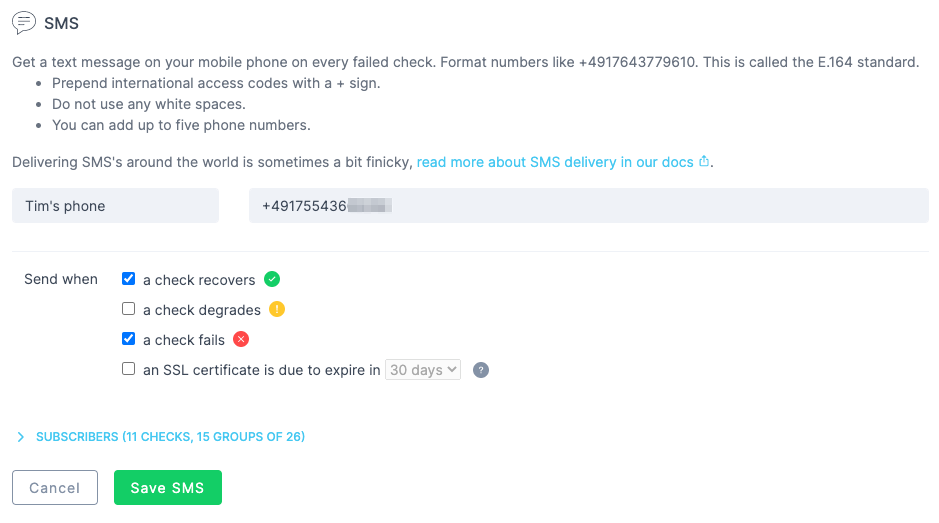

<Tip>
**Monitoring as Code**: Learn more about the [SMS Alert Channel Construct](/constructs/sms-alert-channel).
</Tip>

The phone numbers used for SMS alerting need to be in [E.164 format](https://www.twilio.com/docs/glossary/what-e164) format. Stick to the following rules and you'll be fine:

- Prepend international access codes with a + sign
- Do not use any white spaces
- Use up to 15 characters

You can add as many SMS channels as you like. SMS channels aren't available on the Hobby plan, and SMS sends count against your plan's monthly SMS quota. See the [Pricing page](https://www.checklyhq.com/pricing/#features) for the limits.

## Supported countries and regions

SMS alerts can only be sent to phone numbers in the following countries. Numbers from other countries are rejected when you create or update the channel.

When a number is rejected, the channel form or the API tells you why:

| Message | What to do |
| ------ | ------ |
| `The number field must be a valid phone number` (web app) or `phoneNumber is not a valid phone number` (API) | Enter the number in E.164 format: a `+`, the country code and the number, without spaces or dashes. |
| `Invalid country code. Please see our documentation for a full list of supported countries` | Start the number with `+` and the country code, and use a country from the table below. |
| `SMS to this country requires a paid plan. Upgrade your plan to use this number.` (web app) or `SMS and phone call alerts to this country are only available on a paid plan. Upgrade your plan to use this number.` (API) | The country is available on paid plans only, not on trials. |
| `Adding or changing SMS and phone call alert channels requires the Starter plan or above.` (API) | Your account is on the Hobby plan, which doesn't include SMS alerts. |

| Country | Availability |
| ------ | ------ |
| Argentina (+54) | Paid plans only, not on trials |
| Australia (+61) | All plans with SMS alerts |
| Austria (+43) | All plans with SMS alerts |
| Belgium (+32) | All plans with SMS alerts |
| Brazil (+55) | Paid plans only, not on trials |
| Bulgaria (+359) | All plans with SMS alerts |
| Canada (+1) | All plans with SMS alerts |
| Chile (+56) | Paid plans only, not on trials |
| Colombia (+57) | Paid plans only, not on trials |
| Croatia (+385) | All plans with SMS alerts |
| Cyprus (+357) | All plans with SMS alerts |
| Czech Republic (+420) | All plans with SMS alerts |
| Denmark (+45) | All plans with SMS alerts |
| Estonia (+372) | All plans with SMS alerts |
| Finland (+358) | All plans with SMS alerts |
| France (+33) | All plans with SMS alerts |
| Germany (+49) | All plans with SMS alerts |
| Greece (+30) | All plans with SMS alerts |
| Hong Kong (+852) | Paid plans only, not on trials |
| Hungary (+36) | All plans with SMS alerts |
| Iceland (+354) | All plans with SMS alerts |
| India (+91) | Paid plans only, not on trials |
| Ireland (+353) | All plans with SMS alerts |
| Israel (+972) | Paid plans only, not on trials |
| Italy (+39) | All plans with SMS alerts |
| Japan (+81) | Paid plans only, not on trials |
| Latvia (+371) | All plans with SMS alerts |
| Liechtenstein (+423) | All plans with SMS alerts |
| Lithuania (+370) | All plans with SMS alerts |
| Luxembourg (+352) | All plans with SMS alerts |
| Malta (+356) | All plans with SMS alerts |
| Mexico (+52) | Paid plans only, not on trials |
| Netherlands (+31) | All plans with SMS alerts |
| New Zealand (+64) | Paid plans only, not on trials |
| Norway (+47) | All plans with SMS alerts |
| Paraguay (+595) | Paid plans only, not on trials |
| Poland (+48) | All plans with SMS alerts |
| Portugal (+351) | All plans with SMS alerts |
| Romania (+40) | All plans with SMS alerts |
| Singapore (+65) | Paid plans only, not on trials |
| Slovakia (+421) | All plans with SMS alerts |
| Slovenia (+386) | All plans with SMS alerts |
| South Korea (+82) | Paid plans only, not on trials |
| Spain (+34) | All plans with SMS alerts |
| Sweden (+46) | All plans with SMS alerts |
| Switzerland (+41) | All plans with SMS alerts |
| United Arab Emirates (+971) | Paid plans only, not on trials |
| United Kingdom (+44) | All plans with SMS alerts |
| United States (+1) | All plans with SMS alerts |
| Uruguay (+598) | Paid plans only, not on trials |
| Vietnam (+84) | Paid plans only, not on trials |

## SMS alert number and sender ID

SMS alerts will be sent with a sender ID and phone number. The Checkly sender ID is 'Checkly'. If your carrier does not support sender ID, you will instead see the Checkly SMS alert phone number, +1(814) 250 8623.

## Monthly SMS quota

Each SMS alert that Checkly sends to a channel counts against your account's monthly SMS quota. All SMS channels in your account share the quota, and it starts again at the beginning of each calendar month. See the [Pricing page](https://www.checklyhq.com/pricing/#features) for the quota of each plan. Test messages don't count against the quota.

When your account has used its quota, Checkly doesn't send SMS alerts for the rest of the month. Each alert that isn't sent appears in the [alert notification log](/communicate/alerts/notification-log) with the delivery status **Failed** and the notification result `Account hit the monthly SMS limit`. SMS alerts are sent again from the next calendar month.

Need more SMS or phone calls? Contact [support](mailto:support@checklyhq.com).

## Test messages

Click **Test alert channel** in the channel form to send a test SMS to the number before you save the channel. Accounts on a trial or the Hobby plan can send only a few test messages a day. The limit resets after 24 hours. When you reach that limit, the button shows how many seconds to wait, and the API responds with `429 Too Many Requests` and `Alert channel test rate limit exceeded`. On every plan, you can send at most two tests a minute, counted across all alert channel types. A third test within the minute fails with **Test rate limit exceeded**.

## Troubleshooting a missing SMS alert

Open the [alert notification log](/communicate/alerts/notification-log), select your SMS channel and check **Show failures only**. Select a failed notification to see its notification result:

- `Account hit the monthly SMS limit`: your account used its monthly SMS quota. See [Monthly SMS quota](#monthly-sms-quota).
- `Invalid phone number`: our SMS provider doesn't accept the number. Check the number and its country code, then send a test message.
- `Phone number doesn't support SMS`: the number can't receive SMS, for example because it's a landline. Use a mobile number.
- `Region not enabled`: SMS to the number's country or region can't be sent. Contact [support](mailto:support@checklyhq.com).
- `Attempt to send to unsubscribed recipient`: the number opted out of messages from Checkly, for example by replying `STOP`. To opt back in, reply `START` from that phone to the Checkly SMS number, see [SMS alert number and sender ID](#sms-alert-number-and-sender-id).
- `Incomplete alert channel config`: the channel has no phone number. Edit the channel and add one.
- `FROM number not associated with Twilio account`: a problem with the number Checkly sends from. Contact [support](mailto:support@checklyhq.com).
- `Failed to send the SMS`: the message didn't reach the number through our SMS provider. Check that the number is correct and can receive SMS, then send a test message. If alerts to a correct number keep failing, contact [support](mailto:support@checklyhq.com).

<Note>For limits and other SMS-related questions, please refer to our [Pricing page](https://www.checklyhq.com/pricing/#features).</Note>
