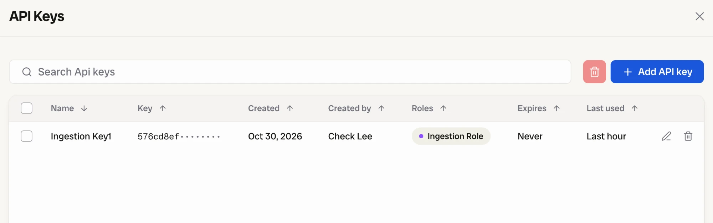
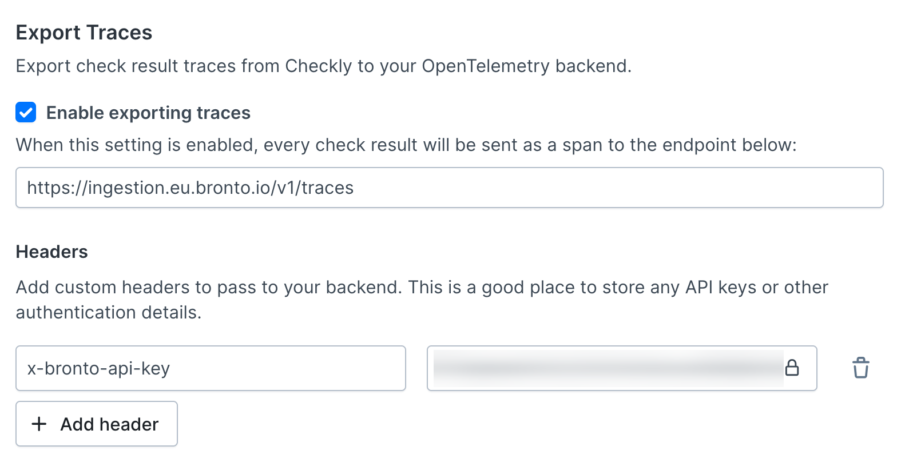
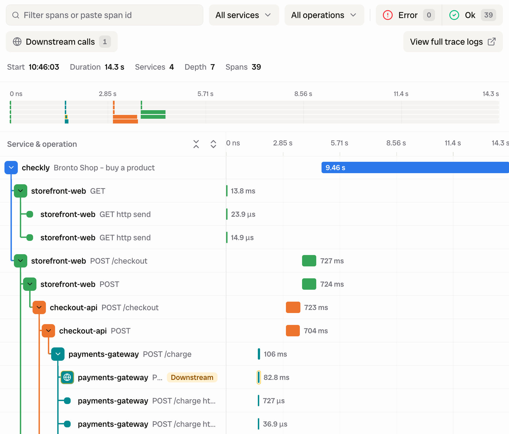

import OtlpVendorIntro from '/snippets/otlp-vendor-intro.mdx';
import OtlpVendorOutro from '/snippets/otlp-vendor-outro.mdx';

<OtlpVendorIntro vendor="Bronto" />

1. Get the endpoint for your Bronto region. EU is `https://ingestion.eu.bronto.io/v1/traces` and US is `https://ingestion.us.bronto.io/v1/traces`.
2. Get the key. In Bronto, open **Settings** > **API Keys**, select **Add API key**, name it and give it the **Ingestion Role**. Copy the key right away, because Bronto shows it once.
   
3. Paste the values into Checkly. On the [Traces settings page](https://app.checklyhq.com/settings/account/traces), turn on **Enable exporting traces**, paste the URL, and add the header from the table below.
   
4. Find the spans. In Bronto, open **Explore Traces**. The spans appear under service `checkly`, with the check's name as the operation.
   

| Header name | Value |
|---|---|
| `x-bronto-api-key` | `<Ingestion API key>` |

Keep the `/v1/traces` path. The base endpoint stores spans as log events and Explore Traces does not show them. Dataset and collection routing applies only to logs, so an `x-bronto-dataset` header row has no effect on traces.

If no spans arrive, check the region before anything else. A key from one region sent to the other region's host does not reach your account.

Bronto indexes span attributes as field predicates with a `$` prefix. To find runs that did not pass:

```text
"$service.name" = 'checkly' AND "$checkly.check.status" != 'PASSED'
```

Group by `$checkly.check.location` to compare locations, or by `$checkly.check.name` to follow one check over time.

Bronto documents the endpoints in [Bronto Ingestion Endpoints](https://docs.bronto.io/getting-started/bronto-endpoints) and this setup in [Checkly synthetic monitoring with OpenTelemetry](https://docs.bronto.io/integrations/checkly).
<OtlpVendorOutro />
