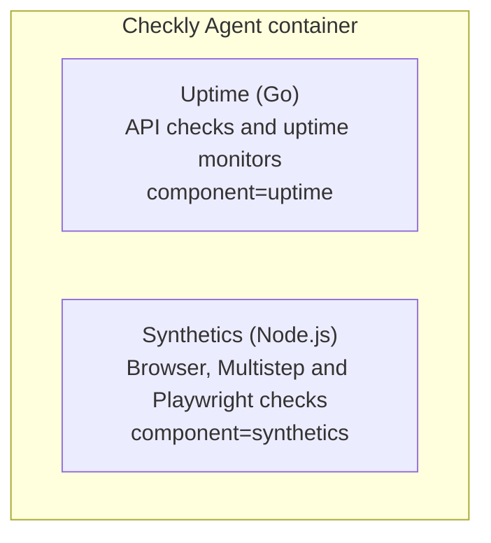

Starting with agent v8.12.0, the Checkly Agent exposes Prometheus metrics at `GET /metrics` on the same port as the health probes (`8080` by default, configurable with [`AGENT_SERVER_PORT`](/platform/private-locations/agent-configuration)). One endpoint covers every check type the agent runs. Each metric carries a `component` label: `uptime` for API checks and uptime monitors, `synthetics` for Browser, Multistep and Playwright checks. The [uptime image](/platform/private-locations/agent-images#uptime-image) only reports `component="uptime"`.

```bash Terminal
curl -s http://localhost:8080/metrics | grep checkly_agent_
```

The agent container runs two processes. Each reports under its own `component` label.



## Agent metrics

These metrics are always on.

Metric|Type|Description
---|---|---
`checkly_agent_checks_slots_total`|gauge|Maximum number of checks the agent can run at the same time.
`checkly_agent_checks_slots_free`|gauge|Number of free check slots.
`checkly_agent_checks_duration_ms`|histogram|Processing time per check, including execution and posting of the result. Labelled with `check_type`.
`checkly_agent_time_waited_ms`|histogram|Time since the agent last acquired a job from the Checkly API.
`checkly_agent_node_worker_scraped`|gauge|`1` when the last scrape included the synthetics worker, `0` when the worker was unreachable.

## Runtime metrics

The endpoint also serves the standard runtime metrics of both agent processes. Use them to size CPU and memory for the container.

Prefix|Component|Source
---|---|---
`go_*`, `process_*`|`uptime`|Go runtime: goroutines, garbage collection, heap, CPU, open file descriptors.
`nodejs_*`, `process_*`|`synthetics`|Node.js runtime: heap, event loop lag, active handles, CPU. Not present on the uptime image.

`process_*` metrics with the same name, such as `process_cpu_seconds_total` and `process_resident_memory_bytes`, appear once per `component`. Sum over `component` to get the container total.

## Check-level metrics

Starting with agent v8.13.0, set `AGENT_METRICS_PER_CHECK=true` to expose one set of series per check. These series carry the labels `check_id`, `name`, `check_type` and `tags`. Timings are in seconds. Histograms have five buckets.

The metrics follow the [Prometheus V2 integration](/integrations/observability/prometheus-v2/), with these differences:

- Names use the `checkly_agent_` prefix.
- `check_type` values are upper-case, for example `API` or `BROWSER`.
- There are no `group`, `muted`, `activated` or `location` labels, and `key:value` tags are not parsed into labels. Add a `location` label in your scrape config.
- Heartbeat metrics and `checkly_time_to_ssl_expiry_seconds` are not reported. Use `checkly_agent_ssl_monitor_days_until_expiry`.
- `checkly_agent_browser_check_errors_total` is a counter.

Metric|Type|Check types|Extra labels
---|---|---|---
`checkly_agent_check_result_total`|counter|all|`status`: `passing`, `degraded` or `failing`
`checkly_agent_check_status`|gauge|all|`status`. `1` for the status of the last result.
`checkly_agent_api_check_timing_seconds`, `checkly_agent_url_monitor_timing_seconds`|histogram|API, URL|`type`: `total`, `wait`, `dns`, `tcp`, `first byte`
`checkly_agent_tcp_monitor_timing_seconds`|histogram|TCP|`type`: `dns`, `connection`, `data`, `total`
`checkly_agent_dns_monitor_timing_seconds`|histogram|DNS|
`checkly_agent_icmp_monitor_timing_seconds`|histogram|ICMP|`type`: `dns`, `latency_avg`, `latency_min`, `latency_max`
`checkly_agent_icmp_monitor_packet_loss_ratio`|gauge|ICMP|
`checkly_agent_traceroute_monitor_timing_seconds`|histogram|Traceroute|`type`: `dns`, `latency_avg`, `latency_min`, `latency_max`
`checkly_agent_traceroute_monitor_hops`, `checkly_agent_traceroute_monitor_destination_reached`|gauge|Traceroute|
`checkly_agent_grpc_monitor_timing_seconds`|histogram|gRPC|`type`: `dns`, `connect`, `total`
`checkly_agent_grpc_monitor_status_code`|gauge|gRPC|
`checkly_agent_ssl_monitor_handshake_seconds`|histogram|SSL|
`checkly_agent_ssl_monitor_info`|gauge|SSL|`tls_version`, `cipher_suite`, `baseline_verdict`, `baseline_grade`. Always `1`.
`checkly_agent_ssl_monitor_days_until_expiry`, `checkly_agent_ssl_monitor_hostname_verified`, `checkly_agent_ssl_monitor_chain_trusted`, `checkly_agent_ssl_monitor_ocsp_stapled`, `checkly_agent_ssl_monitor_key_size_bits`|gauge|SSL|
`checkly_agent_browser_check_duration_seconds`, `checkly_agent_multistep_check_duration_seconds`, `checkly_agent_playwright_check_duration_seconds`|histogram|Browser, Multistep, Playwright|
`checkly_agent_browser_check_web_vitals_seconds`|histogram|Browser|`type`: `TTFB`, `FCP`, `LCP`, `TBT`, `loaded`, `CLS` (score, not seconds)
`checkly_agent_browser_check_errors_total`|counter|Browser|`type`: `console`, `network`, `user`, `document`

<Warning>
**High cardinality.** With `AGENT_METRICS_PER_CHECK=true`, every check adds its own set of series: one per metric, label combination and histogram bucket. An agent that runs hundreds of checks produces a scrape of tens of thousands of series, which costs memory on the agent and on your Prometheus server and slows down dashboards. Enable it only when you need per-check data from the agent, and keep check `name` and `tags` values stable, because every new value creates new series. The agent drops the series of a scheduled check after three missed runs, and the series of a check without a schedule after [`AGENT_METRICS_IDLE_TTL_SECONDS`](/platform/private-locations/agent-configuration).
</Warning>

### Reduce cardinality in Kubernetes

A check can run on any pod of a Private Location, so each check's series appears once per pod. If your scrape config adds `pod` and `instance` labels, you store one series set per check and pod.

For gauges, such as `checkly_agent_check_status` and `checkly_agent_ssl_monitor_days_until_expiry`, you can drop both labels. All pods report the same value for a check, so the last write wins and nothing is lost.

```yaml PodMonitor
metricRelabelings:
  - action: labeldrop
    regex: pod|instance
```

Do not drop these labels from counters and histograms. Several pods then write into one series, the values interleave and `rate()` reports resets. Aggregate them instead, with a recording rule such as `sum without (pod, instance) (rate(checkly_agent_check_result_total[5m]))`, or with an aggregation feature of your metrics backend.
