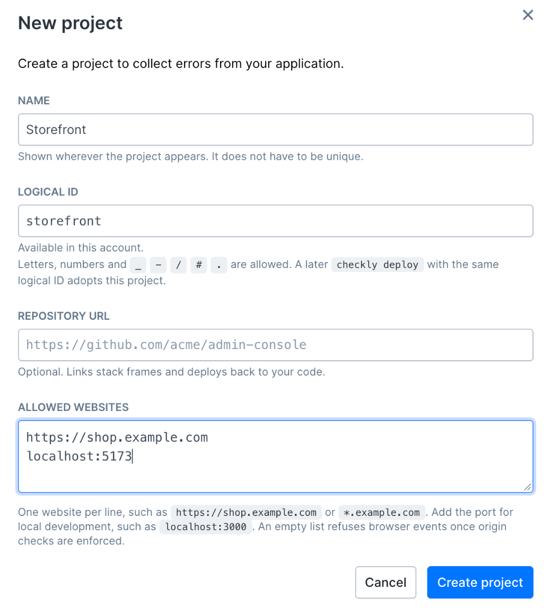

Your application sends Errors to Checkly through the official Sentry SDK. You need a DSN, the address the SDK sends to, for a Checkly project. This page covers browser JavaScript, Node.js, Python, Go, iOS and macOS, Android, React Native, and C and C++ on macOS.

<Accordion title="Prerequisites">

- To create a project: the `projects:create` permission. To create or revoke a DSN, or change the allowed websites of an existing project: `projects:update`. See [Permissions](/admin/team-management/permissions).
- An application you can deploy with a Sentry SDK added.

</Accordion>

## Get a DSN

1. Open the **Errors** page and select **New project**.
2. Enter a **Name** and a **Logical ID**. For a browser application, list your websites in **Allowed websites**, with the port for local development, such as `localhost:5173`. A project with no allowed websites refuses browser Errors. See [Allow only your websites](#allow-only-your-websites).
3. Select **Create project**.
4. Copy the **DSN** the dialog shows.

<Frame>
  
</Frame>

To add a DSN to an existing project, open the project's **Errors** tab, go to the **Ingest keys (DSN)** card and select **Create key**.

A DSN has the form `https://<key>@rum.checklyhq.com/<number>`. It can only write Errors, so it is safe to ship in a browser bundle. Create one key per thing you ship, such as a web bundle, a CI job or a mobile build, so you can rotate them one at a time.

## Configure the SDK

<CodeGroup dropdown={true}>

```bash Browser
npm install @sentry/browser
```

```bash Node.js
npm install @sentry/node
```

```bash Python
pip install sentry-sdk
```

```bash Go
go get github.com/getsentry/sentry-go
```

```swift iOS and macOS
// Package.swift
dependencies: [
    .package(url: "https://github.com/getsentry/sentry-cocoa", from: "9.35.0"),
],
targets: [
    .executableTarget(name: "MyApp", dependencies: [.product(name: "Sentry", package: "sentry-cocoa")]),
],
```

```kotlin Android
// app/build.gradle.kts
dependencies {
    implementation("io.sentry:sentry-android:8.64.0")
}
```

```bash React Native
npm install @sentry/react-native
```

```bash C and C++
git clone --recursive https://github.com/getsentry/sentry-native.git
cmake -B build -S sentry-native -DSENTRY_BACKEND=inproc
cmake --build build --config RelWithDebInfo
cmake --install build --prefix install
```

</CodeGroup>

Initialize the SDK as early as possible, with the DSN, the release you deploy and its environment:

<CodeGroup dropdown={true}>

```js Browser
import * as Sentry from '@sentry/browser'

Sentry.init({
  dsn: '<your-dsn>',
  release: 'storefront@2026.9.3',
  environment: 'production',
})
```

```js Node.js
// instrument.mjs
import * as Sentry from '@sentry/node'

Sentry.init({
  dsn: '<your-dsn>',
  release: 'api@2026.9.3',
  environment: 'production',
})
```

```python Python
import sentry_sdk

sentry_sdk.init(
    dsn="<your-dsn>",
    release="api@2026.9.3",
    environment="production",
)
```

```go Go
package main

import (
	"log"
	"time"

	"github.com/getsentry/sentry-go"
)

func main() {
	err := sentry.Init(sentry.ClientOptions{
		Dsn:         "<your-dsn>",
		Release:     "api@2026.9.3",
		Environment: "production",
	})
	if err != nil {
		log.Fatalf("sentry.Init: %s", err)
	}
	defer sentry.Flush(2 * time.Second)
}
```

```swift iOS and macOS
import Sentry

SentrySDK.start { options in
    options.dsn = "<your-dsn>"
    options.releaseName = "ios-app@2026.9.3"
    options.environment = "production"
}
```

```kotlin Android
// Your Application subclass
import android.app.Application
import io.sentry.android.core.SentryAndroid

class App : Application() {
    override fun onCreate() {
        super.onCreate()
        SentryAndroid.init(this) { options ->
            options.dsn = "<your-dsn>"
            options.release = "android-app@2026.9.3"
            options.environment = "production"
        }
    }
}
```

```js React Native
import * as Sentry from '@sentry/react-native'

Sentry.init({
  dsn: '<your-dsn>',
  release: 'mobile-app@2026.9.3',
  environment: 'production',
})

export default Sentry.wrap(App)
```

```c C and C++
#include <sentry.h>

int main(void)
{
    sentry_options_t *options = sentry_options_new();
    sentry_options_set_dsn(options, "<your-dsn>");
    sentry_options_set_release(options, "agent@2026.9.3");
    sentry_options_set_environment(options, "production");
    sentry_init(options);

    /* your program */

    sentry_close();
    return 0;
}
```

</CodeGroup>

In Node.js with ES modules, load the file with `--import` so the SDK starts before your framework:

```bash Terminal
node --import ./instrument.mjs app.mjs
```

Importing `instrument.mjs` from your entry file is not enough: ES modules are hoisted, so your framework loads before the SDK can instrument it. With CommonJS, use `node --require ./instrument.js app.js`, or require `instrument.js` on the first line of your entry file.

In an iOS or macOS app, call `SentrySDK.start` in your `App`'s `init`.

On Android, initialize the SDK yourself as shown. In `AndroidManifest.xml`, register your `Application` class and turn off the SDK's automatic start:

```xml AndroidManifest.xml
<application android:name=".App">
    <meta-data android:name="io.sentry.auto-init" android:value="false" />
</application>
```

In React Native, `export default Sentry.wrap(App)` replaces your existing `export default App`.

For C and C++, build `sentry-native` with the `inproc` backend as shown, then compile against the installed library:

```bash Terminal
cc main.c -Iinstall/include -Linstall/lib -lsentry -Wl,-rpath,"$PWD/install/lib" -o app
```

The SDK keeps its data in a `.sentry-native` folder in the working directory. Build `sentry-native` with the `inproc` backend because the default `crashpad` backend and the `breakpad` backend send crashes as minidumps, which Checkly does not accept.

Use the same `release` value when you [upload source maps](/resolve/errors/source-maps), so the uploads and the Errors of one build are listed under the same release.

## Confirm the first Error arrives

Send a test Error from your application, for example from a test route:

<CodeGroup dropdown={true}>

```js Browser
Sentry.captureException(new Error('Checkly test Error'))
```

```js Node.js
Sentry.captureException(new Error('Checkly test Error'))
```

```python Python
sentry_sdk.capture_exception(Exception("Checkly test Error"))
```

```go Go
sentry.CaptureException(errors.New("Checkly test Error"))
```

```swift iOS and macOS
SentrySDK.capture(error: NSError(domain: "Checkly test Error", code: 1))
```

```kotlin Android
import io.sentry.Sentry

Sentry.captureException(RuntimeException("Checkly test Error"))
```

```js React Native
Sentry.captureException(new Error('Checkly test Error'))
```

```c C and C++
sentry_value_t event = sentry_value_new_event();
sentry_value_t exc = sentry_value_new_exception("TestError", "Checkly test Error");
sentry_value_set_stacktrace(exc, NULL, 0);
sentry_event_add_exception(event, exc);
sentry_capture_event(event);
```

</CodeGroup>

The Go SDK reports only what you capture: call `sentry.CaptureException`, use `defer sentry.Recover()` for panics, or use the integration for your web framework.

The Error appears on the **Errors** page within about two minutes. The iOS and macOS SDK sends a crash the next time the app starts. In a command-line tool, call `SentrySDK.flush(timeout: 5)` after the capture, or the program exits before the Error is sent. To read stack traces of release builds, [upload source maps or debug files](/resolve/errors/source-maps).

## Count affected users

The **Users** column counts distinct user IDs. Checkly receives user data only when your application calls `setUser()` or turns on `sendDefaultPii` in the SDK, and it keeps the user ID, email and username as sent. To remove fields before they leave your application, use `beforeSend` in the SDK.

## Send through your own domain

The SDK's `tunnel` option sends Errors through an endpoint on your own domain, for example to avoid ad blockers. Your endpoint must forward the envelope to `https://rum.checklyhq.com/api/<number>/envelope/?sentry_key=<key>`, with the number and the key from your DSN. Checkly reads the key from the `sentry_key` query parameter or the `X-Sentry-Auth` header, not from the envelope.

## What Checkly stores

Checkly stores errors and messages. It skips every other kind of data an SDK sends, such as transactions, sessions, replays, logs and attachments, without failing the request.

## Allow only your websites

A DSN is public once it ships in a browser bundle. To stop other websites from sending Errors with it, list your websites in the project's **Allowed origins** card on its **Errors** tab. You can also fill in **Allowed websites** when you create the project.

Checkly checks the `Origin` header of each browser request, or the `Referer` header when there is no `Origin`, and refuses requests from other websites with `403`. Server SDKs send neither header, so their Errors are always accepted.

| Entry | Allows |
|---|---|
| `*` | Every website. Use it on its own line only. |
| `example.com` | `http` and `https` on the default ports |
| `example.com:8080` | `http` and `https` on that port |
| `https://example.com` | Exactly that scheme, host and port |
| `*.example.com` | Every subdomain, but not `example.com` itself |

A project can list up to 50 websites of up to 300 characters each. A project with an empty list accepts no browser Errors. Changes apply within about a minute. Editing the list needs the `projects:update` permission.

## Rotate or revoke a DSN

To rotate a key, ship the new DSN first. In the **Ingest keys (DSN)** card, wait until the old key's **Last used** time stops changing, then select **Revoke**. Checkly refuses Errors sent with a revoked key within about a minute, including from bundles still in a CDN cache.
