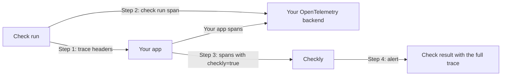

Checkly Traces use OpenTelemetry to correlate synthetic check results with your application's backend traces. The diagram below shows how the dataflows connect to Checkly's monitoring and alerting pipeline.

## The Flow

<Steps>
<Step title="Automatic Instrumentation">
When trace export or the Coralogix integration is enabled, Checkly automatically instruments the HTTP requests made by your checks with `traceparent` and `tracestate` headers. These HTTP requests hit your web application or API when running checks.

API checks, URL monitors, Browser checks and Multistep checks include these headers:

- **traceparent**: W3C compliant trace context. Each check run is one trace, and every request in that run carries the same `traceparent`.
- **tracestate**: Carries `checkly=true` to identify Checkly as the vendor that generated the trace, plus the members documented on the [OTLP page](/integrations/observability/traces/otlp#trace-headers).

Together, these headers propagate the trace context along the request chain. This is the most basic way of tying a synthetic check to your backend traces, though it won't provide much context about the check run itself, like the check name or location.
</Step>

<Step title="Check Result Export">
You can configure your OpenTelemetry backend on [Settings > Traces](https://app.checklyhq.com/settings/account/traces) so Checkly exports every API check, URL monitor, Browser check and Multistep check run as a span to your backend. This correlates all backend spans with the check run that triggered them when your application honors `traceparent`, together with full context of the check run.

Check details are stored in the `checkly` namespace as attributes on the span, such as the check name, check type, run location and tags. See [What is sent](/integrations/observability/traces/otlp#what-is-sent) for the span schema and the tag rules.
</Step>

<Step title="Direct Trace Ingestion">
**No 3rd party backend needed.** This is what kicks Checkly's OpenTelemetry integration into high gear, and it works even if you don't have a 3rd party OTel backend already set up.

By adding the correct OTel libraries and simple filter statements, you can send ONLY the traces related to your Checkly checks back to Checkly:

- **Endpoint**: `otel.eu-west-1.checklyhq.com/v1/traces`
- **Filter**: Only traces marked `tracestate: checkly=true`
- **Result**: Traces appear in Checkly UI alongside check results

Checkly's trace ingestion endpoint is a standard OTel backend endpoint that only accepts traces related to synthetic checks. This keeps your OpenTelemetry setup lean while providing full trace correlation benefits.
</Step>

<Step title="Alert Integration">
When your check breaks, you get an alert that points to a check result containing a full trace of the check run, including all backend spans:

- Complete trace of the check run
- All backend spans included
- Quick root cause identification
- No need to jump between tools or dashboards

This allows you to quickly identify issues without switching between different monitoring tools.
</Step>
</Steps>

<Note>
Steps 3 and 4 provide the most value - complete trace visibility without requiring a 3rd party OpenTelemetry backend.
</Note>