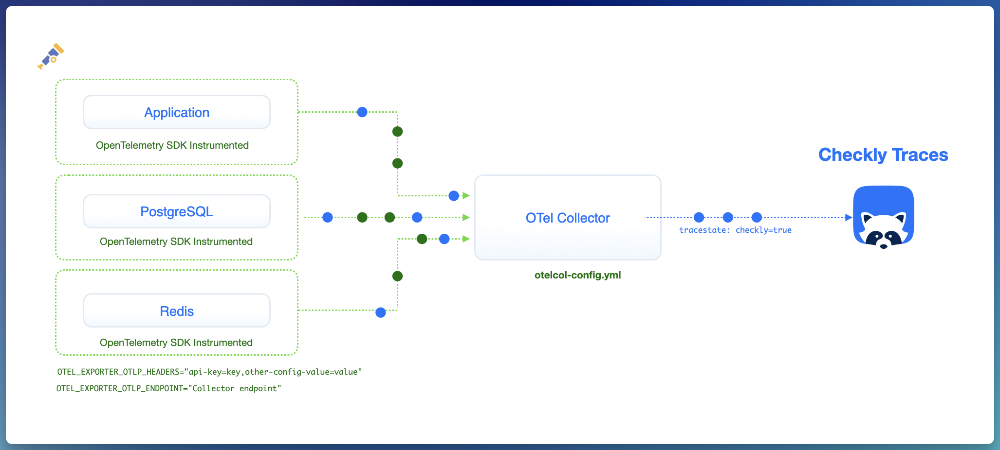
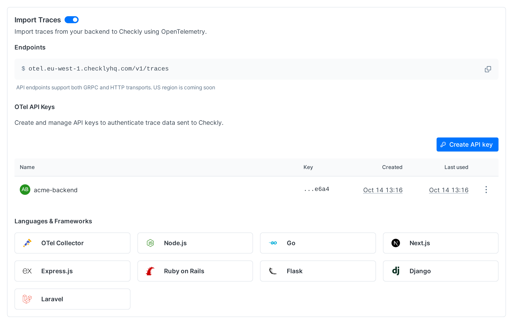
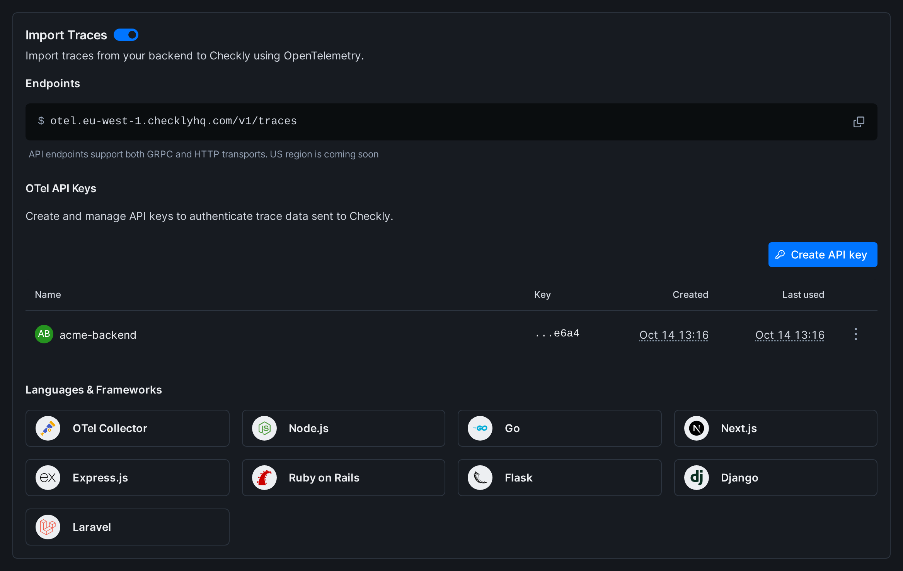
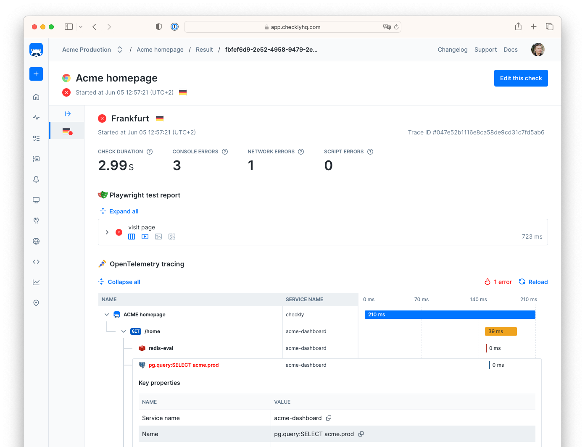

Send your infrastructure OpenTelemetry traces to Checkly. Inspect and drill down to why a check failed or degraded.

In [the Traces tab, in your Checkly account settings](https://app.checklyhq.com/settings/account/traces): 

1. Flip the toggle to import traces in the [Traces settings page](https://app.checklyhq.com/settings/account/traces).
   
2. Get the trace endpoint URL and the API key. Provide them to your OpenTelemetry collector so that it sends traces back to Checkly.

   <Frame>
     
     
   </Frame>

3. Set up your OpenTelemetry collector to only send relevant traces to Checkly. [Setting up the OpenTelemetry Collector](/resolve/traces/import/open-telemetry) 

After you've set this up, you should start seeing traces on the [Traces page](https://app.checklyhq.com/traces). Moreover, when opening a check, you'll see a Traces section within it.

   

